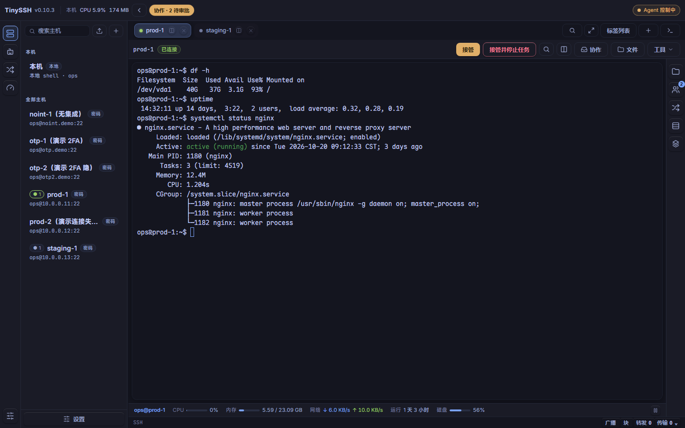
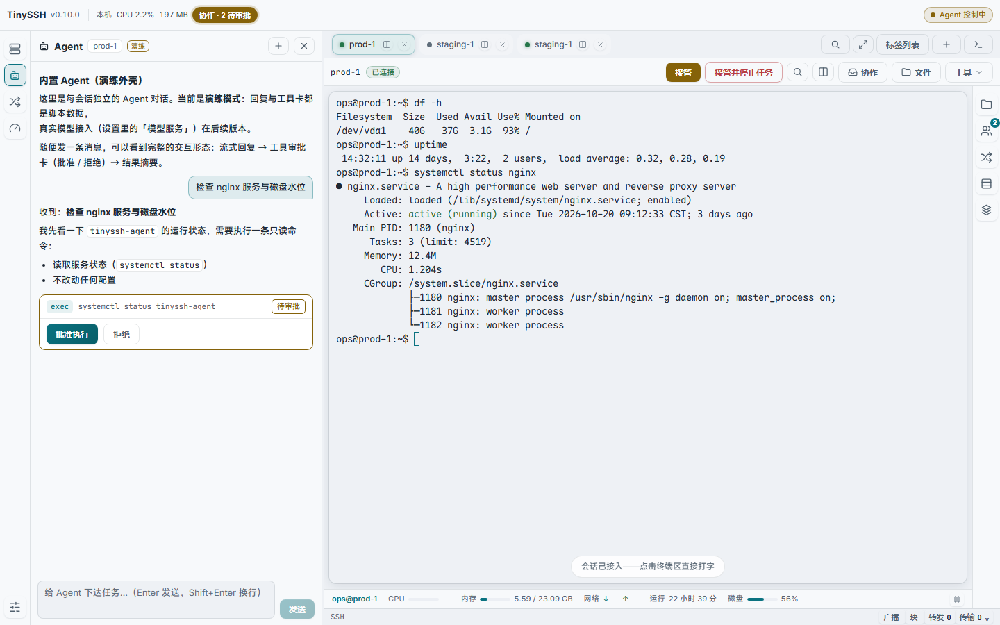
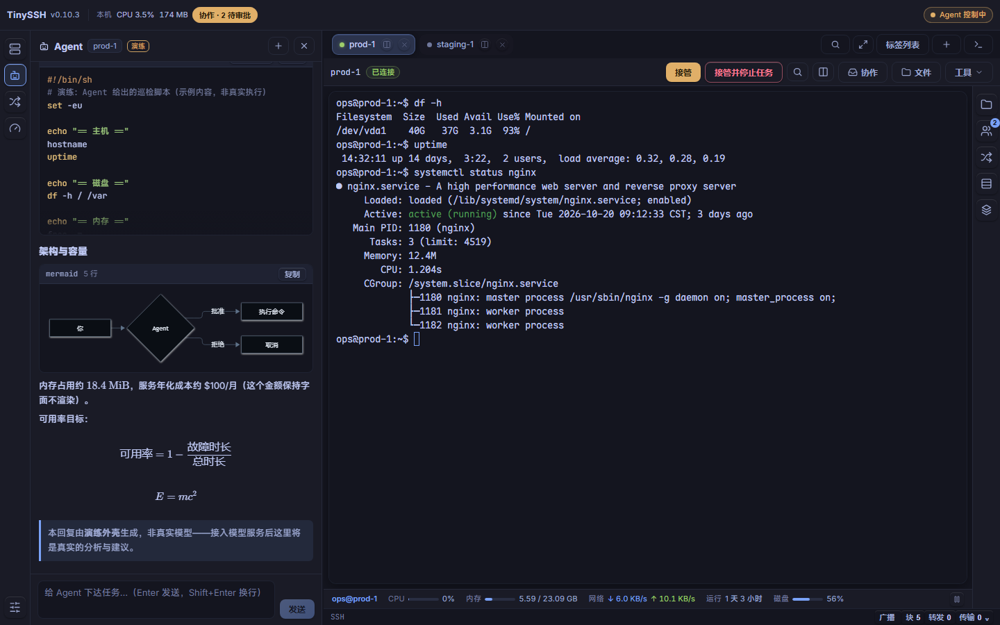
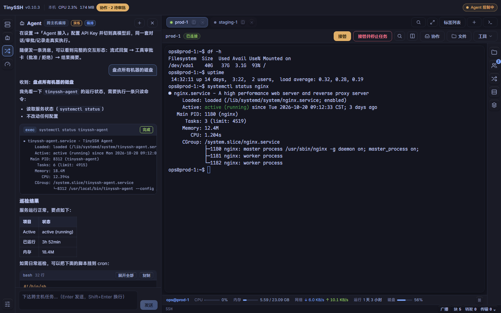
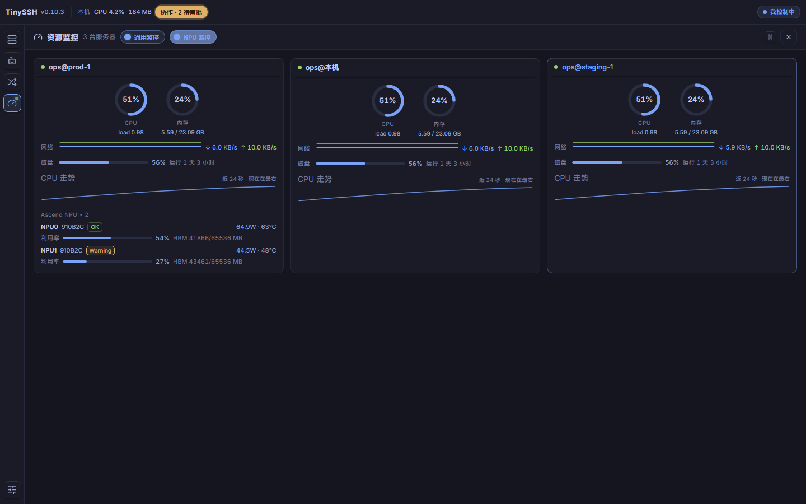
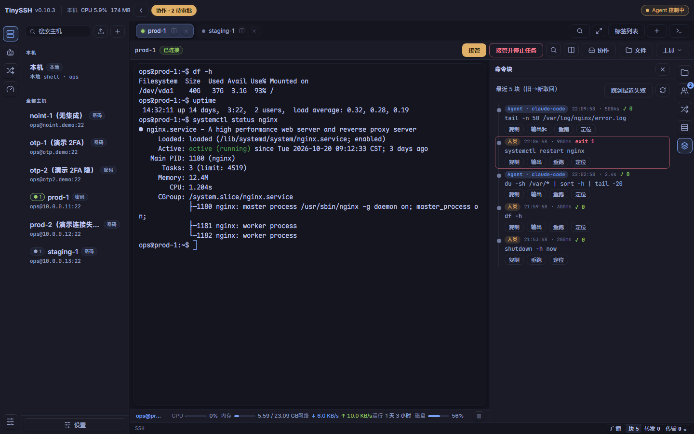
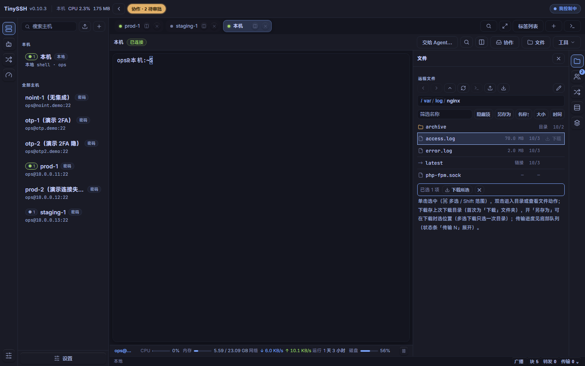
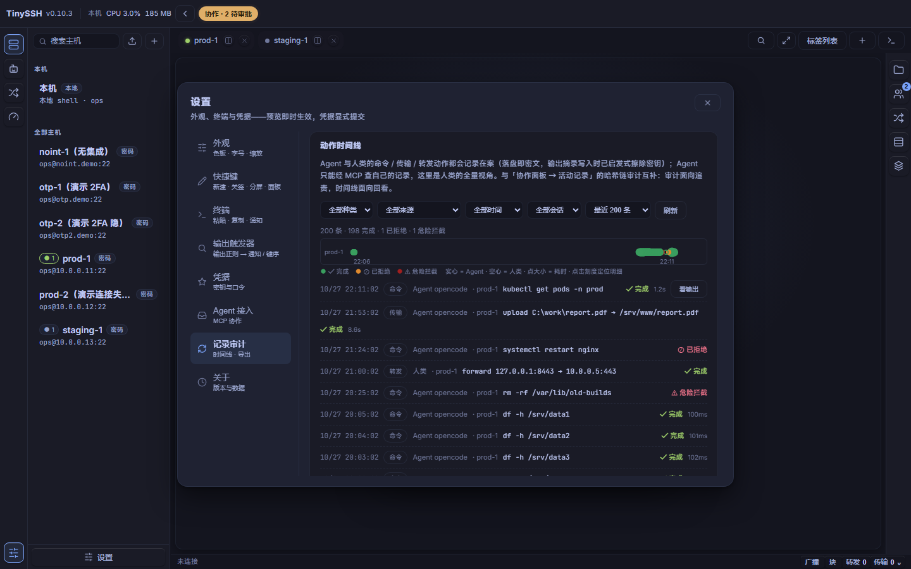

# TinySSH

[](https://github.com/chenpu17/TinySSH/actions/workflows/ci.yml)
[](LICENSE)

A human–AI collaborative terminal: an SSH client, a first-class local terminal, and an embedded AI agent in one desktop app. The agent kernel is the sister project [TinyAgent](https://github.com/chenpu17/TinyAgent) — TinySSH is its first full host, wiring it to real sessions behind approvals, audit, and explicit control hand-off.

中文文档见 [README.zh-CN.md](README.zh-CN.md)。

## Why

If you operate a few to a dozen servers — developing, deploying, troubleshooting — you want connections that just work, a terminal that feels right, file operations when you need them, and occasionally an agent to hand tasks to. Existing tools give you either a good terminal or a scripted AI loop; TinySSH refuses to choose, and refuses to hand your keys to an unattended loop:

- **One approval chain for everyone.** Agent commands walk the same dangerous-pattern gate as a human pasting `rm -rf /` into the terminal. Transfers are always approved, one by one.
- **Explicit control hand-off.** The agent only drives a session after you delegate; you can take over with one click at any time, and everything either of you did is in the record.
- **Autonomy is opt-in and visible.** A per-session autonomy switch skips per-item approvals but keeps hard blocks on dangerous patterns and transfers, banners its state, and has a kill switch. It lives in memory only — a restart revokes it.
- **Everything is recorded.** Structured execution records (including refusals) are encrypted at rest, kept for 30 days, queryable by you *and* by the agent itself. The human view is a two-layer timeline: a per-session swim-lane chart (x = time, color = outcome, solid = agent / hollow = human, dot size = duration, click a dot to jump to the detail row) above the filterable list.

## How it compares

Positioning snapshot at v0.10.4 (October 2026) — categories, not product reviews.

| | TinySSH | Classic SSH clients (XShell, Termius…) | AI terminals (Warp…) |
|---|---|---|---|
| License | Apache-2.0, open source | usually proprietary | usually proprietary |
| Scope | SSH + local terminal + files + monitoring in one app | SSH-centric | local-first shell |
| An agent that really operates your servers | yes — behind approvals, audit, explicit control hand-off | no | common, rarely with per-action approvals and audit |
| Extensibility | built-in MCP server (23 tools) — plug in any agent | plugin systems | limited |
| Delivery | single portable binary, credentials in an encrypted vault | installer | varies |

## Highlights

- **ProxyJump (bastion hops)** — pick a jump host in the host form and connect through existing host entries (up to three chained hops). The hop reuses its own credentials, TOFU trust, editing and audit — no inline secrets. Each hop shows its own fingerprint confirmation and 2FA prompt (labeled "hop N · jump host"), failures name the offending hop, referenced jump hosts can't be deleted, and forwarding/SFTP/agent all ride the final connection unchanged. Quick-connect and the `ProxyJump` directive in `~/.ssh/config` imports are honestly not supported yet.
- **SSH + local terminal, equal citizens** — the built-in "This machine" entry is pinned, un-deletable, auto-opens a terminal at startup; local sessions get the same tabs, splits, command blocks, search, and file browsing as remote ones. Default shell is selectable (PowerShell / PowerShell 7 / Git Bash / cmd / WSL auto-detected; shells without preexec hooks are honestly marked "no command blocks").
- **Interface language** — Settings → Appearance switches 中文 (default) / English instantly (without interrupting terminal sessions). Coverage spans the app chrome and panel interiors: settings, hosts panel, host/quick-connect forms, menus, dialogs, command palette, records, files panel & transfer queue, port forwards, command blocks, collaboration, monitor dash, agent chat, plus toasts and terminal inline notices. Uncovered strings honestly stay Chinese rather than half-translated.
- **Terminal quality** — Unicode 11 width table (CJK/emoji don't misalign), optional ligatures, sixel & iTerm2 inline images, OSC 52 clipboard with an ask/allow/deny policy, OSC 9 notifications, clickable file paths, broadcast input across sessions (iTerm-style), regex output triggers with notification or approval-gated key sequences.
- **Command blocks** — shells with OSC 133/7 integration turn every command into a block with exit code, duration, and captured output (rendered, ANSI-stripped, tail-capped). Remote sessions probe the login shell with a polyglot printf and install per-family hooks — bash/zsh (POSIX sh) and fish (event hooks) get integration; incompatible shells honestly stay Unavailable. Blocks can be copied, re-run (same confirmation chain as paste), located in the scrollback, and the agent reads them through the same API.
- **Session restore** — on clean exit every session gets an encrypted snapshot (scrollback tail + viewport + cursor + modes); next start can rebuild and replay the screen. Reconnects go through the full connection flow — TOFU and 2FA gates included, nothing auto-dials.
- **Embedded agent (per session)** — chat with markdown, Mermaid, KaTeX; reasoning blocks collapse; tool calls appear as inline approval cards. Eight SSH tools (`exec`, `read_blocks`, `read_screen`, `wait_output`, `upload`, `download`, `transfer_status`, `send_keys`) plus an optional `load_skill` executed through the same session actor as everything else. Prompts and skills are customizable assets: append org-specific conventions per agent kind (session helper / Fleet orchestrator) in Settings → Agent — additions never replace the built-in safety rules — and maintain a named playbook library the agent loads with `load_skill`.
- **Fleet orchestration** — a third view dispatches self-contained tasks to per-session agents in parallel and collects results; the dispatcher never touches machines itself, and each target keeps its own approvals and dangerous-command gates.
- **Monitoring** — a per-session resource bar plus a full-screen multi-server dashboard (CPU/mem gauges, disk/net history; Ascend NPU per-chip health/power/temp/utilization/HBM). Sampling is opt-in, per-category, and survives closing the dashboard. The local machine is monitored through native APIs (kernel32/iphlpapi on Windows, /proc on unix) on the same parse path as remote hosts.
- **SFTP + transfer queue** — upload/download drawer with cancel, retry, re-verify for unknown outcomes, reveal-in-explorer and open-with-default-app on completion.
- **Built-in MCP server** — enable it and any MCP-capable agent gets 23 tools (sessions, exec, transfers, forwards, records), subscribable live resources, and guided prompts on `127.0.0.1` (default 8722). Token onboarding via `tinyssh agent create`, HTTP or stdio shim.
- **Single portable exe** on Windows — statically linked CRT, SQLite at rest in an encrypted vault (hosts, credentials, API keys, settings).
- **In-app updates** — a silent GitHub-release check at startup with a toast + Settings → About row when a new version ships. macOS (`.app`/`.dmg`) additionally gets one-click auto-update (signed manifest, download → verify → install → relaunch); the Windows portable exe and Linux tar.gz honestly stay check-and-download (the updater plugin only covers installed app formats there, and there is no AppImage artifact). Release signing is opt-in: maintainers set `TAURI_UPDATER_PUBKEY` / `TAURI_SIGNING_PRIVATE_KEY[_PASSWORD]` secrets and the release workflow attaches `latest.json`; without them builds stay green and the auto-update button simply doesn't appear.

## Screenshots

All shots are the built-in browser demo mode — fake sessions, clearly labeled, same UI as the real app. Dark theme on the **Tokyo Night** palette (the factory default).

| Terminal with host bar and status bar | Agent with inline approval card |
|---|---|
|  |  |
| **Agent answers with rendered diagrams (mermaid) and formulas (KaTeX)** | **Fleet view — one conversation, many hosts, every exec approved** |
|  |  |
| **Multi-server monitoring dashboard (incl. local machine, Ascend NPU)** | **Command blocks — every command attributed human/agent, exit codes, rerun** |
|  |  |
| **Remote files with multi-select batch download** | **Records audit — swimlane timeline, every action accounted** |
|  |  |

## Download

Prebuilt binaries (built by [release workflow](.github/workflows/release.yml), unsigned):

| Platform | Artifact |
|---|---|
| Windows 10/11 x64 | `TinySSH_<ver>_windows_x64_portable.exe` — single file, needs only the built-in WebView2 |
| macOS 11+ / 10.15+ | `TinySSH_<ver>_macos_<arch>.app.zip` or `.dmg` (Apple Silicon & Intel) |
| Linux amd64 | `TinySSH_<ver>_linux_amd64.deb` (auto-dependencies) or `.tar.gz` (bring your own libwebkit2gtk-4.1) |

Each release also ships the `tinyssh` CLI companion and a `SHA256SUMS.txt`. First launch caveats for unsigned builds: Windows SmartScreen → "More info → Run anyway"; macOS right-click → Open (or `xattr -cr /Applications/TinySSH.app`).

Windows is the primary validation platform — the full test suites and real-machine verification rounds run there. macOS (Apple Silicon) has been validated end-to-end on physical hardware since v0.10.3 (launch, day-to-day use, local monitoring and self-overhead readings); the Intel macOS and Linux artifacts are built and unit-tested by CI but have not been validated on physical devices. If something breaks, please open an issue with your platform details.

## Getting started

Prerequisites: Rust ≥ 1.86, Node ≥ 20.

```bash
# Frontend demo mode — runs in a plain browser, no Rust needed
cd ui && npm ci && npm run dev      # http://localhost:5183

# UI test suite (48 specs / 789 checks; needs a Chrome/Edge binary)
TINYSSH_UI_CHROME="C:/Program Files (x86)/Microsoft/Edge/Application/msedge.exe" npm test

# Desktop app (Tauri v2; dev shell expects the ui dev server above)
cargo run -p tinyssh-app

# Release build — custom-protocol embeds the frontend; .cargo/config.toml pins
# static CRT so the exe runs without VC++ Redist
cargo build -p tinyssh-app --release --features custom-protocol

# e2e (needs a docker sshd container: scripts/dev-sshd.sh)
TINYSSH_E2E_SSHD=1 cargo test --workspace
```

Windows notes: high-parallel `cargo test --workspace` can exhaust the page file — use `-j 4`. The first platform is Windows; the ubuntu CI job covers everything except the Tauri shell crate, which is built and tested in the windows CI job.

## Layout

| Crate | What it is |
|---|---|
| `src-tauri` (`tinyssh-app`) | Tauri shell: window, commands, app lifecycle |
| `crates/core-session` | `SessionManager`: sessions, approvals, records, monitoring, probes |
| `crates/session-api` | The `SessionApi` contract + wire types shared with the frontend |
| `crates/transport-ssh` / `crates/transport-pty` | russh channels; local PTY (portable-pty) |
| `crates/term-core` | Terminal semantics (alacritty_terminal) + tree-sitter helpers |
| `crates/approval` | Dangerous-pattern rules and the approval chain |
| `crates/audit` / `crates/records` | SQLite audit; structured execution records (XChaCha20-P1305, redaction) |
| `crates/vault` | Encrypted store: hosts, credentials, keys, KV |
| `crates/mcp-server` / `crates/shim` | rmcp endpoint (23 tools, resources, prompts); stdio→HTTP shim |
| `crates/agent-host` | Embedded agent: TinyAgent kernel + the 8 session tools (+ optional `load_skill`); prompt/skill assets in `assets/` |
| `crates/cli` (`tinyssh`) | Headless `serve` + `agent` onboarding |
| `crates/testbed` | e2e harness against a docker sshd |

The frontend lives in `ui/` (React + xterm.js, TypeScript, Playwright specs). A built-in demo domain mirrors the backend so the whole UI is testable in a browser.

## Documentation

Design docs are written in Chinese: [UX-R1 refactor design](docs/ux/ssh-client-ux-refactor.md), [delivery & acceptance matrix](docs/ux/ssh-client-ux-refactor-delivery.md), [PRD](docs/prd.md), [L0 system design](docs/architecture/l0-system-design.md), [L1 component design](docs/architecture/l1-component-design.md), [execution ledger](docs/ux/ux-r1-execution-status.md) (per-round status), [MCP validation & PV kit](docs/validation-plan.md).

## Status

v0.10.4. All suites green on the primary platform: Rust workspace tests, 52 UI specs / 842 checks, plus real-machine verification rounds recorded in the execution ledger. CI runs on every push (ubuntu: fmt/clippy/core tests/ui build; windows: full workspace).

## Sister project

[TinyAgent](https://github.com/chenpu17/TinyAgent) — a minimal single-binary agent kernel (agent loop, tools, providers) that also builds standalone with a CLI/TUI and Python/TypeScript bindings. TinySSH consumes it as a git dependency, pinned by revision.

## Contributing

PRs are welcome; CI must stay green (fmt, clippy, tests on both runners). Commit messages follow the existing style: a dense one-line Chinese summary. For architecture decisions, read L0/L1 first — cross-crate contract changes need an ADR entry there.

## License

Apache-2.0. Built on [russh](https://github.com/Eugeny/russh), [portable-pty](https://github.com/wez/portable-pty), [alacritty_terminal](https://github.com/alacritty/alacritty), [xterm.js](https://github.com/xtermjs/xterm.js), [Tauri](https://github.com/tauri-apps/tauri), [rmcp](https://github.com/modelcontextprotocol/rust-sdk), and [TinyAgent](https://github.com/chenpu17/TinyAgent).
