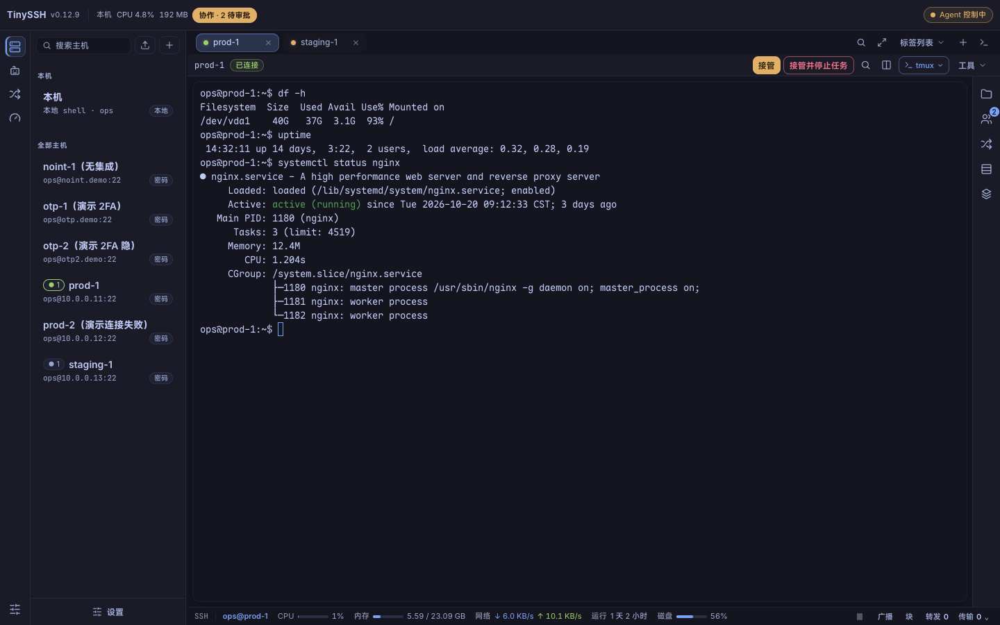
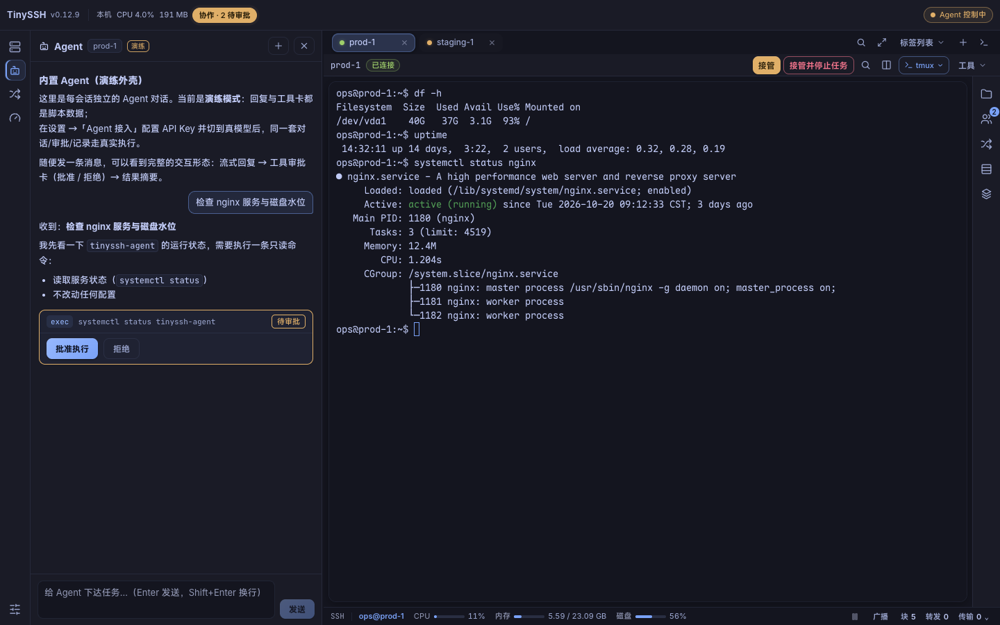
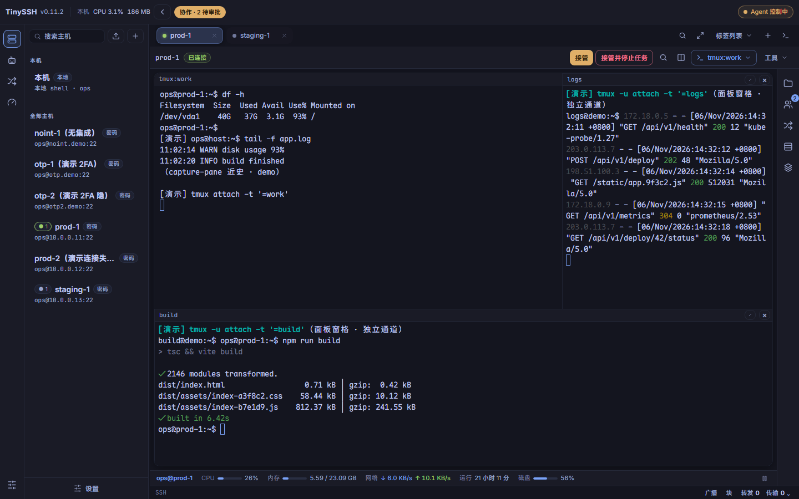
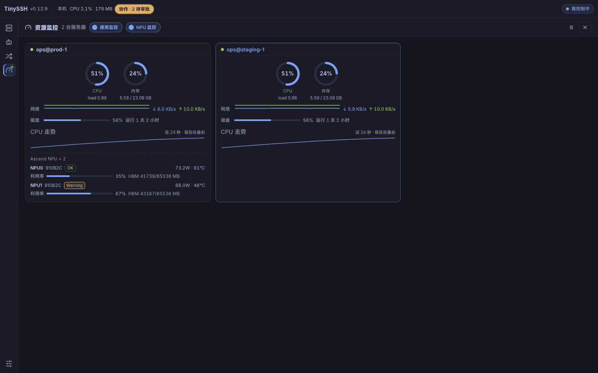
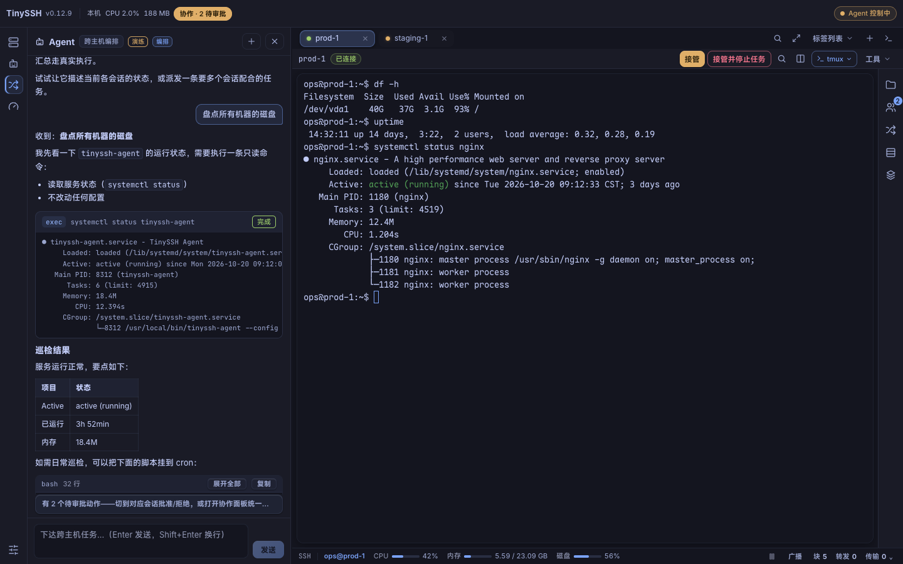
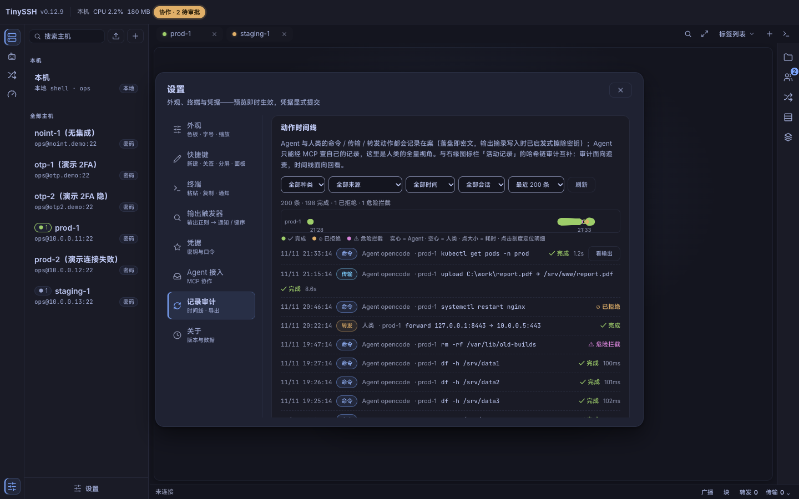

# TinySSH

[](https://github.com/chenpu17/TinySSH/actions/workflows/ci.yml)
[](https://github.com/chenpu17/TinySSH/releases/latest)
[](LICENSE)

**人机协同终端。** SSH 客户端 + 一等公民本地终端 + 内置 AI Agent，一个桌面应用搞定——Windows、macOS、Linux。Agent 内核是姊妹项目 [TinyAgent](https://github.com/chenpu17/TinyAgent)；TinySSH 把它接到真实会话上，全程有审批、审计与显式的控制权交接。

[English](README.md) · **中文**

为同时打理几台到十几台服务器的开发者而做：连接开箱即用、终端手感对路、需要时能传文件、可以把任务交给 Agent——但不必把钥匙也交出去。

## 为什么选它

- **人机同一条审批链。** Agent 执行命令走的是和人类粘贴 `rm -rf /` 同一张危险形态表。传输必审，逐条确认。
- **显式的控制权交接。** Agent 只有在你委派后才驱动会话；随时一键接管。
- **自主模式可选且可见。** 按会话开关，跳过逐条审批，但对危险形态与传输仍硬拦截；状态有横幅提示，带急停开关。仅内存态——重启即失效。
- **一切皆有记录。** 加密的执行记录（含拒绝），保留 30 天，你和 Agent 都可查询，落在双层泳道时间线上。
- **开源。** Apache-2.0，单文件便携，凭据进加密保险库。

| | TinySSH | 传统 SSH（XShell、Termius…） | AI 终端（Warp…） |
|---|---|---|---|
| 许可 | Apache-2.0 | 多为闭源 | 多为闭源 |
| 范围 | SSH + 本地 + 文件 + 监控 | 以 SSH 为主 | 以本地 shell 为主 |
| Agent 操作你的服务器 | 支持——审批 + 审计 + 交接 | 不支持 | 少有逐动作审批 |
| 可扩展性 | 内置 MCP server（24 工具） | 插件 | 有限 |

## 下载

预编译包在 [Releases 页面](https://github.com/chenpu17/TinySSH/releases/latest)（未签名）：

| 平台 | 产物 |
|---|---|
| Windows 10/11 x64 | `TinySSH_<ver>_windows_x64_portable.exe`——单文件，仅依赖系统自带 WebView2 |
| macOS（Apple Silicon 与 Intel） | `TinySSH_<ver>_macos_<arch>.dmg` 或 `.app.zip` |
| Linux amd64 | `TinySSH_<ver>_linux_amd64.deb`（自动装依赖）或 `.tar.gz`（需 libwebkit2gtk-4.1） |

每个 release 还附带 `tinyssh` CLI 与 `SHA256SUMS.txt`。Windows 是第一验证平台；macOS Apple Silicon 已真机验证；Intel macOS 与 Linux 为 CI 构建并跑单元测试。

### 首次启动（未签名构建）

这些构建没有代码签名证书，所以系统首次启动会告警。应用本身没问题——只需一次性放行：

- **macOS**——把 `TinySSH.app` 拖进 `/Applications`，然后**右键 → 打开 → 打开**（不要双击）。或 系统设置 → 隐私与安全性 → **仍要打开**，或 `xattr -cr /Applications/TinySSH.app`。随后可能弹出钥匙串提示（保险库主密钥存在那里）——选「允许」。
- **Windows**——SmartScreen：**更多信息 → 仍要运行**。
- **Linux**——无隔离机制；`.deb` 直接装，`.tar.gz` 解压即用。

## 功能

- **SSH + 本地终端，平起平坐**——置顶的「本机」条目开机自动打开；本地会话享有和远程一样的标签、分屏、命令块、搜索与文件浏览。
- **tmux 一等公民**——接管远程会话；一条连接上最多 6 个并排面板（一次登录、一次 2FA）；全屏实时会话墙；拖拽排布；崩溃安全的工作区记忆，一键恢复。
- **内置 AI Agent**——按会话聊天，支持 markdown / Mermaid / KaTeX 与内联审批卡片；8 个 SSH 工具（`exec`、`read_screen`、`read_blocks`、`wait_output`、`upload`、`download`、`transfer_status`、`send_keys`）；提示词与技能可定制。
- **机群编排**——把自包含任务并行派发给各会话 Agent；派发者本身不碰机器，每个目标各自保留审批。
- **命令块**——OSC 133 shell 集成把每条命令变成一个块，带退出码、耗时与输出；可复制、重跑、定位。
- **广播输入**——打一次，发到多个会话（iTerm 风格）；粘贴与重跑永不广播。
- **输出触发器**——正则规则触发通知或经审批的按键序列；绝不静默自动执行。
- **监控**——按会话的资源条 + 全屏多机仪表盘（CPU/内存/磁盘/网络、昇腾 NPU）；采样可选，本机走原生 API。
- **SFTP + 传输队列**——取消、重试、对未知结果重新校验、完成后在资源管理器中显示 / 打开。
- **主题与可读性**——17 套配色族（明/暗）含护眼与墨水屏；UI 字号 80–125%、两档密度、13 种终端字体；逐格 4.5:1 对比度守护。
- **终端品质**——Unicode 11 宽度（中日韩/emoji 对齐）、sixel 与 iTerm2 内联图片、OSC 52 剪贴板策略、可点击文件路径、macOS 输入法修复。
- **会话恢复**——正常退出时加密快照，下次启动经完整 TOFU/2FA 流程回放。
- **内置 MCP server**——24 个工具、可订阅资源与提示词，跑在 `127.0.0.1`；任何支持 MCP 的 Agent 即插即用（自助文档在 `/integration.md`）。
- **双语界面**——English / 中文（简体），即时切换不打断会话。
- **便携、私密、自更新**——Windows 单 exe；凭据、密钥、记录与快照加密进保险库；macOS/Windows 一键签名自动更新（签名对维护者可选）。

## 截图

内置浏览器 demo 模式——假会话、明确标注，UI 与真应用一致。暗色 **Tokyo Night**（出厂默认）。

| 终端 + 主机栏 | Agent 内联审批 |
|---|---|
|  |  |
| **tmux 并排面板** | **多机监控（含 NPU）** |
|  |  |
| **机群——一个对话，多台主机** | **记录——泳道审计时间线** |
|  |  |

## 从源码构建

前置：Rust ≥ 1.86，Node ≥ 22。

```bash
# 前端 demo——纯浏览器即可跑，无需 Rust
cd ui && npm ci && npm run dev      # http://localhost:5183
npm test                            # UI 套件（headless Playwright）
npm run build                       # tsc + vite

# 桌面应用（Tauri v2；需上面的 ui dev server）
cargo run -p tinyssh-app
cargo test --workspace -j 4         # -j 4 避免 Windows 页面文件耗尽

# Release 构建（custom-protocol 内嵌前端；静态 CRT，无需 VC++ 运行库）
cargo build -p tinyssh-app --release --features custom-protocol

# e2e（需 docker sshd 容器：scripts/dev-sshd.sh）
TINYSSH_E2E_SSHD=1 cargo test --workspace
```

## 文档与贡献

设计文档为中文：[L0 系统设计](docs/architecture/l0-system-design.md) · [L1 组件设计](docs/architecture/l1-component-design.md) · [PRD](docs/prd.md) · [UX-R1 重构](docs/ux/ssh-client-ux-refactor.md) · [已知问题](docs/known-issues.md)。

欢迎 PR——CI 须保持绿（fmt、clippy、双平台测试）。提交信息：一句话中文摘要，密度向既有 git log 看齐。架构决策先读 L0/L1；跨 crate 契约改动需 ADR。内置 Agent 是 [TinyAgent](https://github.com/chenpu17/TinyAgent)，以钉 rev 的 git 依赖引入。

## 许可

Apache-2.0。基于 [russh](https://github.com/Eugeny/russh)、[portable-pty](https://github.com/wez/portable-pty)、[alacritty_terminal](https://github.com/alacritty/alacritty)、[xterm.js](https://github.com/xtermjs/xterm.js)、[Tauri](https://github.com/tauri-apps/tauri)、[rmcp](https://github.com/modelcontextprotocol/rust-sdk) 与 [TinyAgent](https://github.com/chenpu17/TinyAgent) 构建。