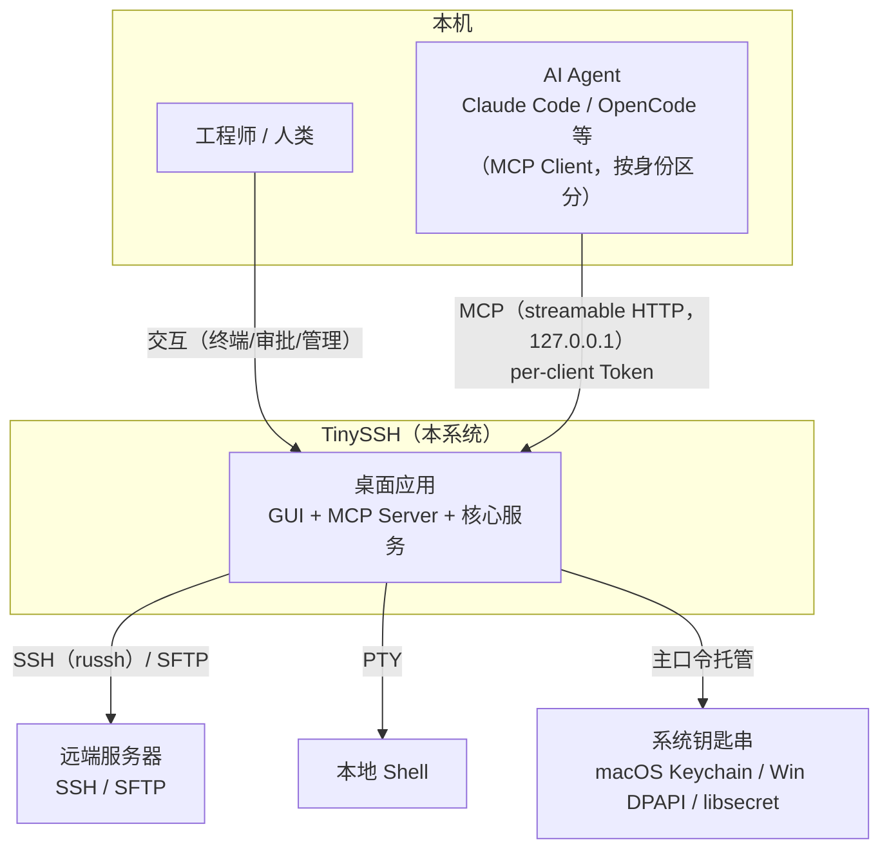
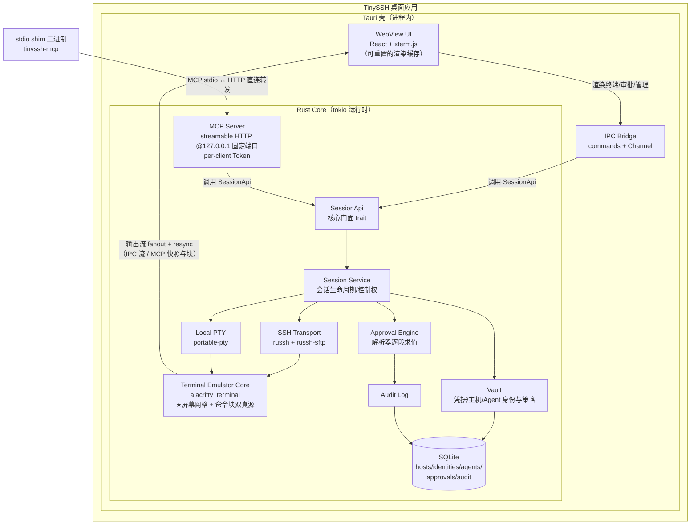

# L0 总体设计 — TinySSH

> 版本：v0.2 · 日期：2026-09-27 · 上游文档：[PRD](../prd.md)
> 本文回答：系统的边界是什么、由哪些部分组成、各部分如何协作、关键技术如何选。模块内部设计见 [L1](l1-component-design.md)。

---

## 1. 系统上下文（C4 Level 1）



**边界声明**

- 系统是**单机单用户**桌面应用；不依赖任何云服务。
- 系统对外的能力出口有且只有两个：**GUI**（人类）与 **MCP Server**（Agent）。不存在第三个入口；本地数据文件不被视为对外接口。
- 系统信任链止于「本机持有有效 Token 的已配置 Agent」：MCP 端点仅绑定 `127.0.0.1` 且要求 per-client Bearer Token，无 Token 一律 401（见 §5 安全边界）。

## 2. 容器视图（C4 Level 2）



**组成说明**

| 容器 | 职责 | 不负责 |
|---|---|---|
| WebView UI | 渲染终端画面、审批队列、主机/密钥管理界面；转发人类输入 | 任何业务逻辑；不得作为查询类接口的数据来源（渲染缓存可被真源整体重置） |
| IPC Bridge | Tauri commands（请求/响应）+ Channel（输出流）；把 SessionApi 暴露给 UI | 协议转换以外的逻辑 |
| SessionApi | **核心门面**：双前端（UI/MCP）唯一调用的 trait | —— |
| Session Service | 会话生命周期、控制权、exec 串行队列、SSH/PTY 通路统一抽象 | 协议实现 |
| SSH Transport / Local PTY | russh 连接、通道、SFTP；本地 PTY | 审批、审计 |
| Terminal Emulator Core | VT 解析、屏幕网格与**命令块索引**（FR-10）；输出 fanout、快照、resync | 渲染、审批 |
| Approval Engine | 逐段求值（解析器）、策略、队列、TTL 授权窗口 | UI 展示 |
| Audit Log | 追加写审计事件与查询 | —— |
| Vault | 主机库、凭据、Agent 身份与审批策略的存取加密 | 密钥协商逻辑 |
| MCP Server | MCP 协议端点；工具实现 = 调 SessionApi | 业务规则 |
| stdio shim | 独立小二进制：对 Agent 说 MCP stdio，向应用 HTTP 端点直连转发（带 Token） | 业务规则 |

## 3. 关键数据流

### 3.1 人类操作流（基线）

```
键盘输入 → IPC Bridge → SessionApi.send_keys → SSH/PTY 通路
SSH/PTY 输出字节 → Terminal Emulator Core（网格 + 命令块索引更新）
                → broadcast 输出流 → IPC Channel → xterm.js 渲染
```

人类输入**不走审批门**（Actor::Human 短路策略求值），命令经命令块进入审计。

### 3.2 Agent exec 流（含审批，产品核心路径）

```
Agent --MCP exec--> MCP Server --SessionApi.exec(Actor::Agent)-->
  Approval Engine 逐段求值(命令, 主机, Agent身份, 策略)
     ├─ 危险模式命中 → 拒绝（结构化错误回 Agent）
     ├─ allow 命中（逐段全部命中/TTL 窗口有效）→ 放行
     └─ 默认 → 进入审批队列，挂起等待
            GUI 审批卡片 → 批准 / 拒绝 / 编辑后批准（超时=拒绝）
  放行后：
     shell 模式（V1 默认）→ 写入会话持久 shell（现场延续），边界由命令块判定
     fresh 模式（可选）  → 独立 exec 通道执行
                          → 结果镜像回放 term-core（Agent 标注，人类全程可见）
  → 结构化结果回传 Agent；全链路写 Audit
```

### 3.3 Agent 交互流（P1）

```
Agent --read_screen--> Terminal Emulator Core.snapshot()（真源导出，不经网络通道）
Agent --send_keys--> 会话级授权检查 → 通路写入 → 输出照 3.1 流转
人类接管 → Session Service 置位控制权 → Agent send_keys 返回 ControlTaken 错误
```

## 4. 技术选型总览

| 层 | 选型 | 选择理由 | 备选（何种情况下切换） |
|---|---|---|---|
| 应用壳 | **Tauri v2** | 包体积/内存小；核心逻辑可全 Rust；更新/签名工具链全 | Electron（若 xterm.js 在 WKWebView 出现不可解的渲染缺陷——概率低） |
| 前端 | **React + TypeScript + xterm.js** | xterm.js 是事实标准（VS Code 同款）；定位为「可重置的渲染缓存」而非真源（ADR-2） | Svelte（无必要） |
| SSH 协议 | **russh ≥ 0.61** + russh-sftp | 纯 Rust、活跃维护、Zed 远程开发背书；**≥0.61 含 keyboard-interactive 路径漏洞修复**；OpenSSH 证书/agent 转发能力随版本演进，SPIKE-2 核实支持矩阵 | libssh-rs（需 GSSAPI/X11 等边角能力时） |
| 密钥解析/生成 | **ssh-key** + russh-keys | OpenSSH 格式解析的事实标准库 | —— |
| 本地 PTY | **portable-pty** | WezTerm 维护，三平台覆盖（Win 用 ConPTY） | 自封装 nix/libc（不必要） |
| 终端仿真核心 | **alacritty_terminal** | 完整 VT/xterm 语义，可直接当库用；是「单一真源」的载体（网格 + 命令块，ADR-9） | wezterm-term（若需要更丰富的协议特性） |
| 命令解析（审批） | **tree-sitter-bash** | 审批逐段求值、防前缀绕过（FR-4 安全语义） | 解析失败即审批（保守降级，语义不变） |
| 异步运行时 | **tokio** | 生态默认 | —— |
| 存储 | **SQLite（rusqlite）** + 加密文件 | 单文件、嵌入、事务；审计追加写友好；user_version 顺序迁移 | sqlx（若需要编译期校验的复杂查询——本期不需要） |
| 凭据加密 | **argon2**（KDF）+ **age / XChaCha20**（载荷）+ 系统钥匙串（主密钥托管） | 密码学组件均久经审计 | ring 直接封装（无必要） |
| MCP | **官方 Rust SDK（rmcp）≥ 2.0.0**，streamable HTTP + stdio | 协议一致性省心；**≥2.0.0 含 streamable HTTP server 漏洞修复（CVE-2026-63128 / RUSTSEC-2026-0189），作为版本门**；SPIKE-3 验证 annotations/resources 合规 | 自实现 JSON-RPC 子集（SDK 不可用时，工具集小，可控） |
| 日志/遥测 | **tracing** + 本地滚动文件 | 结构化、可排查 | —— |
| IPC | Tauri **Channel + 二进制载荷**（非 JSON 事件流） | SPIKE-1 的关键：高频输出流必须走原始字节 | 降级方案：本地 WebSocket 直连 WebView（见 ADR-8） |

## 5. 安全边界（L0 级原则）

1. **凭据边界**：私钥/口令仅存在于 Vault 与内存；SessionApi 任何方法不返回凭据明文；审计只记命令与输出摘要，不记凭据；agent 转发默认关闭。
2. **MCP 端点边界**：仅绑定 `127.0.0.1` 固定端口；**per-client Bearer Token**（每个接入的 Agent 独立身份，可单独吊销）；无 Token 或未知 client 一律 401。
3. **审批边界**：审批在 **Rust 核心层**强制（Approval Engine 在 SessionApi 门面之后、通路之前），UI 与 MCP Server 都绕不过；Agent 的审批模式由人类按 client 预配置，协议层不可自选。
4. **信任边界**：Agent 是**不可信调用方**。Agent 能通过 SSH 账号做的事不受本系统约束（这是 SSH 的能力，不是本系统的），系统约束的是「未经审批不得执行」与「全程可审计」。此边界必须在产品文案中明示。

## 6. 关键架构决策记录（ADR 摘要）

| # | 决策 | 背景 | 后果 / 代价 |
|---|---|---|---|
| ADR-1 | WebView UI（Tauri）而非纯 Rust GUI（egui/iced/gpui） | 终端渲染用 xterm.js 质量最高、成本最低；纯 Rust GUI 需自研终端渲染，周期不可控 | 依赖系统 WebView 差异；Linux webkitgtk 弱（回退渲染器） |
| ADR-2 | 屏幕状态真源在 Rust（alacritty_terminal）；**xterm.js 定位为有状态的渲染缓存**——可丢弃、可被真源快照整体重置（resync），不得作为任何查询类接口的数据来源 | MCP read_screen/wait_output 与 GUI 必须共享同一状态；xterm.js 自带 grid/buffer，「无状态」是自欺，必须显式管理而非否认 | 需自研 grid→快照序列化（含 scrollback 上限重建）；resync 协议：broadcast Lagged/心跳失步检测 → 全量快照 → UI reset+重放；SPIKE-1/2 含失步重放用例 |
| ADR-3 | exec 双通路：`shell` 持久会话（**验证版默认**，现场延续，边界由命令块判定）/ `fresh` 独立通道（可选，结果镜像回放屏幕） | 交接闭环（PRD 核心体验）要求现场延续；「一次性 ssh 无状态」是本产品批评的痛点，不能在自己主路径上复现；fresh 保留给纯结构化执行 | 验证版要求试点主机 opt-in shell 集成注入（落审计、可卸载）；拒绝注入主机降级 fresh 并明示限制；两通路语义对照表见 L1 §3.1 |
| ADR-4 | MCP 双传输：streamable HTTP（127.0.0.1 固定端口 + per-client Token）+ stdio shim；**shim 直接对 HTTP 端点转发，不设 UDS/named pipe 内部端点** | GUI 应用不适合直接做 stdio server（进程模型冲突）；shim 的存在已满足 stdio 需求，UDS 层是多余的传输栈且在 Windows 不成立（named pipe + DACL 成本） | shim 取 Token 经环境变量注入；Agent 配置文件含 Token 明文（残余风险，威胁模型登记） |
| ADR-5 | 审批强制在核心层，不依赖 UI；审批模式由人类按 Agent 身份预配置 | 审批是安全边界不是 UI 特性；UI 缺位/被绕过时安全语义不变 | Agent 无 GUI 场景（无审批者在线）会挂起→超时拒绝语义 |
| ADR-6 | 本地单用户，数据 SQLite 单文件 | MVP 明确不做云同步/多用户（PRD §6.2） | 未来上云同步需迁移层（表结构预留 updated_at/deleted_at） |
| ADR-7 | 输出流允许丢弃中间字节；**UI 是可丢弃缓存，失步时以全量快照 resync（见 ADR-2），最终状态以真源为准** | 真源在仿真核心，UI 流只是视图加速；背压策略简化为「丢流 + resync 保态」 | 终端 scrollback 由仿真核心持有；MCP 的 wait_output 走独立的**无损有界环形缓冲**（与可丢流的 UI 通道隔离，见 L1 §3.2） |
| ADR-8 | IPC 吞吐若不达标，降级路径为「WebView 经 localhost WebSocket 直连 Rust 流」 | 预设退出通道，避免 SPIKE-1 失败后架构停摆 | 平行维护一条通路（仅在降级时启用） |
| ADR-9 | **终端语义层**：term-core 维护「屏幕网格 + 命令块索引」双真源（OSC 133 注入 + 启发式兜底） | 审计完整性（人类命令入审计）、块级审批上下文、`shell` 模式 exec 的退出码、会话交接简报都依赖结构化命令块；数据结构晚定必返工 | 远程主机注入 shell 集成是显式、落审计的 opt-in 动作；启发式检测有误判率（FR-10 AC 约束） |

## 7. 部署形态与演进

- **形态**：验证阶段（V0/V1）仅分发 macOS（dmg）；V2 起三平台（Windows NSIS / Linux deb+AppImage）。独立 `tinyssh-mcp` shim 二进制随包分发。
- **预留演进**（不在本期）：
  - **Headless 模式**：Rust Core + MCP Server 以 daemon 跑在服务器上，GUI 作为远端前端——SessionApi trait 边界已为此预留（核心不依赖 Tauri 类型）。
  - **团队/云同步**：SQLite → 服务端 API，Vault 保持端侧加密。

## 8. Spike 清单（V0 阶段执行；进入 V1 的前置 gate）

> 平台矩阵：验证阶段（V0/V1）仅 macOS（Apple Silicon）必测；Windows（x64）在 V2 启动前补测；Linux 最后。

| Spike | 验证内容 | 通过标准 | 失败动作 |
|---|---|---|---|
| SPIKE-1 | Tauri v2 Channel 二进制载荷吞吐：Rust 持续推送**真实终端录制流**（vim/htop/tail -f 回放，非随机字节）→ xterm.js 渲染；含失步 resync 演练 | ≥ 10 MB/s 持续 60s，UI 不冻结；强制丢块后经快照 resync 状态与真源一致 | 启用 ADR-8 降级路径重测 |
| SPIKE-2 | russh ≥0.61 交互会话 ↔ alacritty_terminal 集成：连真实 sshd，跑 vim/htop/tail -f；keyboard-interactive/证书支持矩阵核实 | 与 OpenSSH 直连的屏幕快照做**字节级对比一致**（剔除时序差异）；1k 行/s 刷屏下 RSS 稳定（无泄漏） | 评估 wezterm-term 替换 |
| SPIKE-3 | rmcp ≥2.0.0 端点 ↔ Claude Code 端到端 `exec`（含审批挂起/恢复） | rmcp 版本门达标；annotations/resources 合规用例通过；批准/拒绝/超时/编辑后批准四条语义断言通过；**120s 审批挂起不被 Claude Code 客户端侧超时截断**；exec P95 < 300 ms | 改自实现 JSON-RPC 子集 |
| SPIKE-4（V2 前） | 本地 PTY（macOS + **Windows ConPTY**）× term-core | vim/htop 正常渲染；resize 传播正确；命令块索引在本地 shell 上工作 | 评估 ConPTY 适配层补丁 |

## 修订记录

| 版本 | 日期 | 说明 |
|---|---|---|
| v0.1 | 2026-09-27 | 初稿：上下文/容器视图、数据流、选型、ADR-1~8、Spike 清单 |
| v0.2 | 2026-09-27 | 评审修订：ADR-2 改写（xterm.js=可重置渲染缓存 + resync 协议）；ADR-4 删除 UDS 内部端点（shim 直连 HTTP，消除 Windows named pipe 问题）；ADR-7 与 ADR-2 对齐并隔离 MCP 无损缓冲；新增 ADR-9 终端语义层；选型表加 rmcp ≥2.0.0 / russh ≥0.61 版本门与 tree-sitter-bash；安全边界加 per-client Token；数据流补 exec 镜像回放；Spike 补平台矩阵、真实流载荷、量化标准与 SPIKE-4 |
| v0.3 | 2026-09-27 | 专家评审修订（对应 PRD v0.3）：ADR-3 对调默认模式（Shell 升为验证版默认，交接闭环要求现场延续）；数据流同步；平台矩阵收窄为验证阶段仅 macOS、SPIKE-4 移至 V2 前；部署形态分阶段 |
