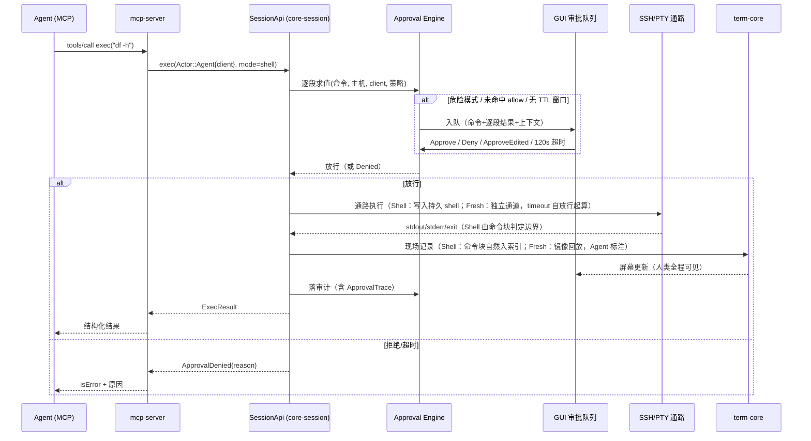
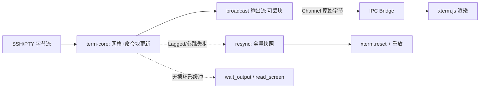

# L1 模块设计 — TinySSH

> 版本：v0.7 · 日期：2026-10-06 · 上游：[PRD](../prd.md) · [L0 总体设计](l0-system-design.md) · [UX-R1](../ux/ssh-client-ux-refactor.md)
> 本文回答：每个模块的职责、对外接口、关键流程时序、数据模型与安全机制。接口签名是**设计约定**，实现期允许在不改变语义的前提下微调；标注 `v1` 的接口为 V0 末冻结范围，其余为草稿、随阶段经 ADR 增量冻结。

---

## 0. UX-R1 实施增量与兼容边界

本轮优先建设 SSH 客户端体验；原有模块设计与协作契约继续作为基础。下方 V0/V1/V2 阶段映射为历史，实施排序以 [UX-R1 任务与验收](../ux/ssh-client-ux-refactor-delivery.md) 为准。以下为待实现设计，现有接口不能被视为已经具备这些能力。

| 模块 | 本轮增量 | 约束 |
|---|---|---|
| `session-api` / `core-session` | C1 建连尝试与取消、C2 初始 owner、C3 shell 能力/拒绝、C5/C6 传输任务、C9 admission | 原子人类控制；提交未知不得伪终态；C3 明确收紧静默降级，其余旧协议按兼容测试执行 |
| `transport-ssh` | C4 SFTP 路径/元数据、C5 进度、C6 冲突与提交能力 | 未知字段明确；确认未提交时保护原目标；提交响应未知可恢复，不伪造原子支持 |
| `vault` | C7 导入诊断、C8 版本化 UI 元数据与设置迁移 | 旧主机、凭据引用、指纹、Agent Token 保留；迁移原子、幂等 |
| `src-tauri` / `ui` | adapter、TerminalRegistry、统一 action/focus、新工作区、C10 输出生命周期 | UI 持有视图状态，core 持有执行状态；真源与审计不能从 xterm 反推 |
| `mcp-server` / `cli` | 兼容并回归既有入口 | UI 新开关不代替授权；旧配置不因迁移静默断开；新增协议有显式类型/错误测试 |

C1–C10 详细行为与建议接口由 [UX-R1 §9](../ux/ssh-client-ux-refactor.md) 统一维护，避免在两处复制不同版本。G0 冻结 wire 类型时补充本文相应模块的正式签名与 schema；需要改变既有安全语义时另建 ADR，不得仅更改前端条件分支。

本轮已登记 ADR-12–14：提交阶段和 OutcomeUnknown、Shell 不可用执行前拒绝、协作停用先封 Agent admission。以下 API 草案中的状态/字段不代表完整新 wire；R03 必须同步正式类型和契约 fixture。旧客户端不获得静默 Fresh 兼容例外，需确认返回稳定错误且命令零副作用。

## 1. Workspace 划分（Cargo crates）

```
TinySSH/
├── crates/
│   ├── session-api/      # 核心门面 trait + 领域类型（含审批类型，见 §1.1；无实现、无重依赖）
│   ├── core-session/     # SessionApi 实现：会话编排、控制权、exec 串行队列、审批/审计挂接
│   ├── transport-ssh/    # russh 封装：连接/通道/SFTP/跳板
│   ├── transport-pty/    # portable-pty 封装：本地 shell
│   ├── term-core/        # alacritty_terminal 封装：网格+命令块双真源、快照、fanout、resync
│   ├── approval/         # 审批引擎：tree-sitter-bash 逐段求值、队列、TTL 窗口
│   ├── audit/            # 审计事件写入与查询
│   ├── vault/            # 主机/凭据/Agent 身份与策略存取与加密
│   ├── mcp-server/       # MCP 工具实现（HTTP 端点）
│   └── shim/             # tinyssh-mcp stdio 转发二进制（直连 HTTP 端点）
├── src-tauri/            # 应用壳：装配各 crate、Tauri commands、Channel 桥
└── ui/                   # React + TypeScript + xterm.js
```

**依赖规则**（违反即架构腐化，评审必查）：

- `mcp-server` 与 `src-tauri`（IPC Bridge）**只依赖 `session-api`**，不依赖 `core-session` 内部 —— 这是「双前端对等」的落地机制；
- `session-api` 仅依赖 tokio 与基础类型库；
- **审批契约类型（`Policy`/`Decision`/`Actor` 等）定义在 `session-api`**（门面契约的一部分），`approval` crate 只做实现——否则 session-api 反向依赖 approval，违反上一条；
- `term-core` 不感知审批/审计；`approval` 不感知协议实现。

## 2. 核心门面：SessionApi

双前端唯一入口。所有方法都带 `Actor` 上下文，审批与审计在门面之后强制挂接（L0 ADR-5）。**标注 `v1` 的方法为 M0 冻结范围**（M1/M2 所需全集）；其余随 M3 经 ADR 增量冻结。

```rust
// crates/session-api/src/lib.rs（设计约定）

#[async_trait::async_trait]
pub trait SessionApi: Send + Sync {
    // ---- 主机与凭据（v1；PRD FR-2）----
    async fn list_hosts(&self, ctx: &Actor) -> Result<Vec<Host>>;
    async fn upsert_host(&self, ctx: &Actor, host: HostDraft) -> Result<HostId>;      // v1
    async fn delete_host(&self, ctx: &Actor, id: HostId) -> Result<()>;               // v1
    async fn list_identities(&self, ctx: &Actor) -> Result<Vec<IdentityMeta>>;        // v1
    async fn create_identity(&self, ctx: &Actor, req: IdentityReq) -> Result<IdentityMeta>; // 生成/导入；v1
    async fn delete_identity(&self, ctx: &Actor, id: IdentityId) -> Result<()>;       // v1
    // 注：任何方法不返回私钥明文；IdentityMeta 仅含 label/kind/fingerprint。

    // ---- 会话（v1；PRD FR-1/FR-4）----
    async fn list_sessions(&self, ctx: &Actor) -> Result<Vec<SessionInfo>>;           // v1
    async fn create_session(&self, ctx: &Actor, req: CreateSessionReq) -> Result<SessionId>; // v1
    async fn close_session(&self, ctx: &Actor, sid: SessionId) -> Result<()>;         // v1
    //   Agent 调用时：远程主机默认需审批；控制权在人类或会话活跃时拒绝关闭。
    async fn resize(&self, ctx: &Actor, sid: SessionId, cols: u16, rows: u16) -> Result<()>; // v1

    // ---- exec（v1；PRD FR-3/FR-4）----
    async fn exec(&self, ctx: &Actor, sid: SessionId, cmd: &str, opts: ExecOpts)
        -> Result<ExecResult>;                                                        // v1
    async fn cancel_exec(&self, ctx: &Actor, sid: SessionId, exec_id: ExecId) -> Result<()>; // v1

    // ---- 交互式（P1；PRD FR-6）----
    async fn read_screen(&self, ctx: &Actor, sid: SessionId) -> Result<ScreenSnapshot>;
    async fn send_keys(&self, ctx: &Actor, sid: SessionId, keys: &str) -> Result<()>;
    async fn wait_output(&self, ctx: &Actor, sid: SessionId, opts: WaitOpts)
        -> Result<OutputChunk>;
    async fn set_control(&self, ctx: &Actor, sid: SessionId, owner: ControlOwner, opts: ControlOpts)
        -> Result<TakeoverReport>;   // 接管/归还；契约见 §3.1（PRD FR-6）

    // ---- 传输（P1；PRD FR-7）----
    async fn upload(&self, ctx: &Actor, sid: SessionId, local: &Path, remote: &str)
        -> Result<TransferHandle>;
    async fn download(&self, ctx: &Actor, sid: SessionId, remote: &str, local: &Path)
        -> Result<TransferHandle>;
    async fn cancel_transfer(&self, ctx: &Actor, t: TransferId) -> Result<()>;

    // ---- 审批（v1 读取路径；PRD FR-4）----
    async fn list_approvals(&self, ctx: &Actor, f: ApprovalFilter) -> Result<Vec<ApprovalItem>>; // v1
    fn subscribe_approvals(&self) -> broadcast::Receiver<ApprovalEvent>;              // v1
    async fn decide_approval(&self, ctx: &Actor, id: ApprovalId, d: Decision) -> Result<()>;     // v1

    // ---- 审计（v1；PRD FR-5）----
    async fn query_audit(&self, ctx: &Actor, f: AuditFilter) -> Result<AuditPage>;    // v1
    async fn export_audit(&self, ctx: &Actor, f: AuditFilter, to: &Path) -> Result<()>; // JSONL；v1

    // ---- 现场简报（v1；交接核心工件，PRD FR-3/FR-6）----
    async fn get_session_brief(&self, ctx: &Actor, sid: SessionId) -> Result<SessionBrief>; // v1

    // ---- 人类专属：输出流订阅（IPC Bridge 用；MCP 不提供流，只提供快照/等待）----
    fn subscribe_output(&self, sid: SessionId) -> broadcast::Receiver<OutputEvent>;
}
```

**关键类型**（v1 冻结前必须全部定义完毕）

```rust
pub enum Actor {
    Human,                                          // GUI：短路审批
    Agent { client_id: AgentClientId },             // 身份来自 MCP Token；审批模式由 vault 中
                                                    // 人类预配置的策略决定，协议层不可传入
}

#[derive(Default, Clone, Copy)]
pub enum ExecMode { #[default] Shell, Fresh }       // Shell=V1 默认（现场延续）；Fresh 可选（纯结构化执行）

pub struct ExecOpts {
    pub mode: ExecMode,
    pub timeout: Duration,      // 默认 30s；**自审批放行起算**（不含审批等待）
    pub output_cap: usize,      // stdout/stderr 返回上限，默认 128 KiB，超限截断并标 truncated
    pub env: BTreeMap<String, String>,   // 仅 Fresh 模式生效
}

pub struct ExecResult {
    pub exec_id: ExecId,
    pub exit_code: Option<i32>, // Fresh 模式必为 Some（含信号映射）；Shell 模式来自命令块
    pub stdout: String, pub stderr: String,   // UTF-8，无效序列以替换符呈现并标 has_binary
    pub has_binary: bool, pub truncated: bool,
    pub duration: Duration,     // 自放行起算
    pub approval: ApprovalTrace,
}

pub enum StopPolicy { None, BestEffort }   // 停止运行中任务：显式选项、尽力语义（SIGINT→TERM→KILL）
pub struct ControlOpts { pub stop_running: StopPolicy }

pub enum StopOutcome { Exited(i32), Escalated, Unresponsive }
pub struct TakeoverReport {                // 「接管拿回了什么」逐项呈现，不谎报（PRD FR-6）
    pub frozen: bool,
    pub paused_queue: Vec<ExecId>,
    pub stopped: Vec<(ExecId, StopOutcome)>,
    pub brief: SessionBrief,               // 接管即附现场简报
}

pub enum Epistemic { Confirmed, NeedsRecheck, Unobservable }
// 三层认知状态（PRD FR-6）：Confirmed=系统可直接观察的事实；
// NeedsRecheck=发生过操作但结果需重读的对象（如"曾在 vim 中编辑 nginx.conf"→ Agent 先重读再操作）；
// Unobservable=屏幕之外、系统未追踪的状态——明确留空，不冒充已知。
// 简报不承诺文件内容级追踪；V0 不建全量文件追踪系统。

pub struct BriefFact { pub subject: String, pub detail: String, pub status: Epistemic }

pub struct SessionBrief {                  // 现场简报：交接核心工件（PRD FR-6）
    pub cwd: Option<String>,               // Confirmed（SSH 重连后降级 NeedsRecheck，见 §3.1）
    pub env_summary: String,
    pub facts: Vec<BriefFact>,             // 命令块/操作归并的事实清单，逐条带认知状态
    pub running: Vec<ExecId>,              // Confirmed（断线后置 Unobservable：状态未知，须核实）
    pub pending_approvals: Vec<ApprovalId>,
    pub screen_summary: String,
}
```

**错误模型**（Agent 可感知的语义必须稳定，MCP 层原样映射；枚举封闭，新增走 ADR）：

```rust
pub enum Error {
    ApprovalDenied { reason: DeniedReason },  // Denied | ApprovalTimeout | DangerousPattern
    ControlTakenByHuman,                      // 会话控制权在人类（send_keys/close 等）
    VoidedByHandback { brief: Box<SessionBrief> }, // 交接前未开始的请求因接管作废（不自动执行），附最新简报
    ReconfirmingPending,                      // 会话处于重确认态：仅允许内置只读核实命令
    ShellIntegrationUnavailable,              // UX-R1 ADR-13 拟新增：Shell 不可用，用户命令尚未执行，禁止自动 Fresh
    SessionNotFound, SessionClosed,
    AuthFailed, ConnectFailed,
    ExecTimeout,                              // 执行超时（与 ApprovalTimeout 区分）
    Cancelled,                                // cancel_exec / cancel_transfer
    QueueBusy { position: u32 },              // exec 串行队列（前端可提示排队）
    InvalidActor, InvalidInput(String),
    Storage(String), Io(String),
}
```

## 3. 模块设计要点

### 3.1 core-session（会话编排）

- 持有 `HashMap<SessionId, SessionHandle>`；`SessionHandle = { 通路: ChannelHandle, 终端: term-core 句柄, 控制权: ControlOwner, exec 队列, 元数据 }`
- **通路抽象** `ChannelHandle`：`transport-ssh` 与 `transport-pty` 各实现一套（open/write/resize/exec_fresh/signal/close）
- **exec 双通路语义对照表**（设计约束，实现不得偏离）：

| 维度 | Fresh（可选） | Shell（V1 默认，依赖 FR-10） |
|---|---|---|
| SSH 实现 | 同连接上开**独立 exec channel** | 写入会话持久 shell channel，边界由命令块判定 |
| 本地实现 | 隐藏子进程按用户 shell `-c` 执行（**可拿真实 exit code**，不注入交互 PTY） | 写入会话 PTY，边界由命令块判定 |
| 退出码 | 可靠（channel exit-status / waitpid） | 来自命令块（OSC 133；启发式模式下可能缺失） |
| shell 状态（cwd/env） | 不延续（`env` 参数可注入） | **延续**——修复「一次性 ssh 无状态」痛点 |
| 屏幕可见性（旅程 1） | **结果镜像回放** term-core：命令行+输出+退出码注记，带 Agent 标注块 | 天然可见（就在共享屏幕上） |
| 审计 | 记录命令+结果+审批留痕 | 同左，命令块同源 |
| 并发 | 会话内**串行队列**（第二个 exec 排队，返回 QueueBusy 供提示） | 同左 |

> **默认 `Shell` 模式，能力不足先拒绝（UX-R1 ADR-13）**：shell 集成须 opt-in；未启用或检测未就绪时，在用户命令副作用前返回 `ShellIntegrationUnavailable`。调用方须另发显式 `Fresh` 请求并按原策略授权，或由人启用集成并确认能力后重试 Shell。禁止自动降级以及事后 UI 告知替代执行前决定；新旧调用方同规则。普通人类终端输入不依赖该 exec 能力。

- **exec 镜像回放桥**：Fresh 结果组装为带标注的命令块写回 term-core（与 FR-10 块结构同构）——这是旅程 1「人类全程可见」的落地机制，不可省略。
- **接管契约**（PRD FR-6，`set_control` 落地）：
  1. **冻结**（默认，<1s）：`ControlOwner` 原子切到 Human；Agent 的 `exec/send_keys/upload/close_session` 一律被拒（`ControlTakenByHuman`）；排队 exec 全部挂起并在 `TakeoverReport.paused_queue` 列出；
  2. **停止运行中任务**（显式选项 `ControlOpts.stop_running = BestEffort`）：对运行中 exec 按 SIGINT→SIGTERM→SIGKILL 升级，`StopOutcome` 逐条呈现真实结果（`Exited(code) | Escalated | Unresponsive`），**不谎报成功**；
  3. **不承诺回滚**：已发生的修改不自动恢复——由操作记录与现场简报支持人工判断（诚实标注的能力边界）；
  4. **交还契约**（PRD FR-6/旅程 0.1）：
     - 作废口径（**接管生效时即触发**）：交接前产生、**尚未开始执行**的全部请求——**待审批、已批准待执行、排队中的传输**——一律作废并留痕；待审批卡片作废后不可再生效；已开始运行的任务遵循第 2 条停止契约。阻塞中的调用返回 `VoidedByHandback { brief }`；
     - 核心规则：**交还后先更新上下文，再重新决定后续动作；旧请求不得仅因恢复控制权而自动执行**。Agent 读取最新简报后重新提交——防「旧上传覆盖人工修复」「相对路径命令在已变化的现场执行」类事故；
     - Agent 获知路径：阻塞调用即时返回；空闲中的 Agent 由人类回到其对话窗口发送继续指令（V0 不做服务端推送，体验限制如实告知）；
     - 简报带三层认知状态（`Epistemic`）：Agent 对 `NeedsRecheck` 对象先重读核实再操作，`Unobservable` 明确留空——GUI 与 MCP 同源。
- **人机同时输入**：每会话输入锁——人类输入始终优先透传；Agent `send_keys` 在人类 2s 内有输入活动时延迟排队，避免字符交错。
- **重连状态机与重确认流程**：本地 shell 会话随进程存活天然保留；SSH 会话断线 → `Connected → Degraded → Disconnected`，UI 显式提示；重连成功后新通道接入同一 term-core（**只保留显示历史与操作记录，不等于现场延续**——原 shell 的 cwd/env 随连接消失，旧画面不是现场连续的证据）。重连后进入 `Reconfirming`：
  - 简报中 SSH 侧的 cwd/env 事实降级为 `NeedsRecheck`；**运行中任务事实置为 `Unobservable`（状态未知：nohup/systemd 任务可能仍在运行，不得当作已结束、不得自动重试）**；
  - **重确认机制（选定方案）**：Agent 的普通动作被拒（`ReconfirmingPending`），仅开放**客户端内置的只读核实命令白名单**（固定清单：`pwd`/`printenv`/`which`/`ps`/`systemctl status` 等，Agent 不可自选、不走出库定义）；
  - **完成判定由核心自动执行**：白名单核实结果回填简报（SSH 侧事实恢复 `Confirmed`）后自动退出 `Reconfirming`，UI 全程显示状态；真正的远程会话恢复（tmux 类）单独评估，不在 V0 范围。
- **Agent 输入可视化标注**：SSH 远端回显无法从字节流归因按键来源，由 **UI 层**在 send_keys 生效的时间窗内对回显区域叠加标注（近似呈现，文档如实标注）。

### 3.2 term-core（屏幕网格 + 命令块双真源）

- 输入字节流 → alacritty_terminal `Term` 网格更新 + **BlockIndex** 更新（L0 ADR-9）：
  - 块边界：OSC 133（A/B/C/D 标记）优先；本地 shell 默认注入集成片段；远程主机 opt-in（落审计）；无集成时**提示符启发式检测**兜底（正则 + 时间间隔启发），FR-10 AC 约束准确率
  - 块结构：`{命令文本, 起止时间, exit_code, 输出区间(行号范围), 来源: Human|Agent{client}}`
- **两路输出 + 一路缓冲**：
  1. **UI 流**：`tokio::broadcast<OutputEvent>`（Raw 字节 / Meta 事件）——允许丢块（L0 ADR-7），慢消费者由 resync 补齐；
  2. **MCP 无损缓冲**：独立的**有界环形缓冲**（默认 8 MB，可配），专供 `wait_output`——与可丢流的 UI 通道隔离，杜绝「丢块导致漏匹配 → 假超时」；匹配域 = **渲染后文本**（剥离 ANSI 后），正则语义明确，raw 字节匹配不在 v1 范围；
  3. **快照 API**：`snapshot(style)` 从网格渲染纯文本/ANSI + 光标 + alt-screen 状态；`grid→快照` 序列化（含 scrollback 上限重建）为自研工作项（alacritty_terminal 无现成 API）。
- **resync 协议**（ADR-2）：broadcast `Lagged` 或 UI 心跳超时 → 该 UI 连接标记失步 → 推送全量快照（网格 + scrollback + 光标 + alt-screen）→ 前端 `xterm.reset()` + 重放 + 滚动位置恢复到「距底 N 行内贴底，否则保持」。
- `wait_output` 的静默期 = 无损缓冲尾时间戳超过 quiet_ms；busy 判定（alt-screen + 近期持续输出）供审批卡片展示「该会话正在交互程序中」。

### 3.3 approval（审批引擎）

```rust
// 契约类型在 session-api；此处为实现结构
pub struct Policy {                 // 按 (agent_client, host) 维度存储于 vault（PRD FR-3/FR-4）
    pub allow_rules: Vec<AllowRule>,   // agent × host × 命令模式；保存时强制影响面预览
    pub ttl_windows: Vec<AuthWindow>,  // TTL 授权窗口：{agent, host, scope, expires_at}
    pub deny_rules: Vec<DenyRule>,     // 内置默认 + 用户追加；内置项不可删除
    pub default_mode: Mode,            // RequireApproval（默认）
}
pub enum Decision { Approve, Deny, ApproveEdited(String) }
```

- **求值顺序：deny → allow/TTL → default**；实现为**解析器逐段求值**（tree-sitter-bash）：
  1. 解析命令为 AST；失败（语法不完整、heredoc、不识别结构）→ 直接进入审批（保守降级，语义安全）
  2. 含命令替换 `$(...)`/反引号、多段（`;`、`&&`、`||`、管道）→ **逐段**判定，任一段未命中 allow → 需审批（防 `systemctl status; reboot` 绕过）
  3. 单段命令按模式匹配（前缀/精确/正则）
- `RiskLabel`（只读/写/破坏性…）字段预留，P2 启用风险分级路由（PRD 理念备选池）
- **ApprovalMode 由人类按 client 预配置**（存 vault），MCP 请求/连接参数不可指定——堵「Agent 自选弱审批」
- 队列条目带完整上下文（命令、逐段求值结果、主机、Agent 身份、会话 busy 状态、近期块摘要）；按「同一任务爆发」分组（同 Agent 5 分钟窗口同类模式聚合展示）；合并条目**逐条批准**，`ApproveEdited` 只作用于被批准的那一条
- **会话级授权**（send_keys）：一次审批生成 `{agent, session, expires: 接管或会话结束}` 的授权态，逐次写入留痕
- **TTL 授权窗口**：限时免审（默认 2h）、到期自动收回、GUI 一键撤销、全部留痕——为无人值守与 P2 Playbook 预留
- 超时（默认 120s）→ `ApprovalDenied{ApprovalTimeout}`；SPIKE-3 验证真实客户端不先超时
- **交接联动**：接管生效时，该会话全部 `pending` 审批条目转为 `voided`（不可再批准），已批准未执行请求的执行权同时失效——与交还契约同一作废口径（PRD FR-6 v0.5）；`Reconfirming` 期间新审批请求照常受理，但执行被重确认门槛拦截

### 3.4 vault（凭据 / 主机 / Agent 身份）

- SQLite 明文存非敏感字段；凭据载荷（私钥 PEM、口令）以主密钥加密存 BLOB
- 主密钥来源：系统钥匙串托管的随机 32B（macOS Keychain / Win DPAPI / libsecret）；可选「主口令模式」（argon2id 派生，无恢复手段，UI 显式警示）
- 解密句柄 `Zeroizing<...>` 包裹；`Debug/Serialize` 实现禁止输出明文；`SessionApi` 无任何返回凭据的方法
- 存 **Agent 身份**（client_id ↔ Token 哈希）与按 client 的审批策略（§3.3）

### 3.5 mcp-server 与 shim

- 工具实现 = 参数校验 → 组装 `Actor::Agent{client_id}`（**身份仅来自 Token**）→ 调 `SessionApi` → 错误映射为 MCP `isError` 载荷（永不挂起：审批等待表现为长时工具调用，超时返回结构化拒绝）
- **端点**：`127.0.0.1:<固定默认端口>`（被占递增，实际端口持久化并在 GUI 展示）；无 UDS/named pipe 内部端点（L0 ADR-4）
- **per-client Token 生命周期**：CSPRNG 生成 32B、仅存哈希于库、原始 Token 仅签发时展示一次；请求校验用常数时间比较；轮换/吊销即时生效（内存态 Token 表）；shim 经环境变量（`TINYSSH_TOKEN`）取 Token——Agent 配置文件含 Token 明文为**已登记残余风险**（§7）
- `tinyssh-mcp` shim：`stdio ↔ HTTP` 透明转发（对 Agent 说 stdio MCP，向应用端点说 streamable HTTP），单文件、无状态、体积 < 5MB
- UX-R1 C9 停用只管理应用拥有的 MCP 端点、核心 admission 和已接纳请求；外部 Agent 启动的 shim 可继续存活，其调用在停用期间被拒绝/端点不可用。不以外部进程退出作为 Disabled 条件，也不忽略其已接纳的在途请求。
- 输出编码：`ExecResult` 的 stdout/stderr 为 UTF-8 字符串，含无效序列时置 `has_binary` 并以替换符呈现（MCP JSON 无二进制通道；二进制文件走 upload/download 工具）

## 4. MCP 工具规格（v1）

| 工具 | 输入（关键字段） | 输出 | annotations | 审批 | 错误语义 |
|---|---|---|---|---|---|
| `list_hosts` | — | `[{id,name,address,tags}]` | readOnly | 免 | — |
| `list_sessions` | — | `[{id,host,state,control_owner}]` | readOnly | 免 | — |
| `create_session` | `host_id`, `interactive?` | `{session_id}` | — | 远程默认**必审**（主机可配免审）；本地免 | AuthFailed / ApprovalDenied |
| `exec` | `session_id`, `command`, `mode?=shell`（fresh 必须显式请求）, `timeout?` | `{exec_id,exit_code,stdout,stderr,truncated,duration}` | destructive | **必审**（allow/TTL 命中除外，逐段求值） | ApprovalDenied / ExecTimeout / QueueBusy / ShellIntegrationUnavailable（UX-R1 拟增） |
| `cancel_exec` | `session_id`, `exec_id` | `{}` | — | 免（落审计） | NotFound |
| `upload` / `download` | `session_id`, 路径对 | `{transfer_id, bytes}` | destructive | **必审** | ApprovalDenied |
| `close_session` | `session_id` | `{}` | — | 免；**控制权在人类时拒绝** | ControlTakenByHuman |
| `get_session_brief` | `session_id` | `SessionBrief`（§2；交接核心工件，交还时 GUI 与 Agent 同源） | readOnly | 免 | — |
| `query_audit` | `filter{session?,host?,actor?,range?}` | 分页事件 | readOnly | 免 | — |
| `read_screen` *(P1)* | `session_id`, `style: text\|ansi` | 快照 | readOnly | 免（只读） | — |
| `send_keys` *(P1)* | `session_id`, `keys`, `submit?` | `{}` | destructive | **会话级授权**（一次审批） | ControlTakenByHuman |
| `wait_output` *(P1)* | `session_id`, `quiet_ms?`, `regex?`, `timeout` | 新增输出块（渲染后文本） | readOnly | 免 | ExecTimeout |

资源：`sessions://list`（只读）。审计查询走 `query_audit` 工具（MCP resources 无标准分页语义，不用资源承载）。Prompt 模板不做（未列入 PRD）。

## 5. 关键时序

### 5.1 Agent exec + 审批（核心路径，fresh 模式）



### 5.2 输出流 fanout 与 resync（GUI 渲染路径）



慢消费者的背压策略：broadcast lag 超阈值即丢最旧块；**失步检测（Lagged 或心跳超时）触发全量快照 resync**，最终状态以真源为准（L0 ADR-2/7）。

## 6. 数据模型（SQLite DDL 草案）

> 迁移策略：`user_version` 顺序迁移，启动时执行；所有表含 `created_at`，业务表含 `updated_at/deleted_at`（ADR-6 预留软删除）。

```sql
CREATE TABLE hosts (
  id TEXT PRIMARY KEY, name TEXT NOT NULL, group_id TEXT,
  address TEXT NOT NULL, port INTEGER DEFAULT 22, username TEXT NOT NULL,
  auth_type TEXT CHECK(auth_type IN ('key','password','agent','keyboard-interactive')),
  identity_id TEXT REFERENCES identities(id), jump_host_id TEXT REFERENCES hosts(id),
  tags_json TEXT DEFAULT '[]',
  created_at INTEGER, updated_at INTEGER, deleted_at INTEGER
);
CREATE INDEX idx_hosts_group ON hosts(group_id);

CREATE TABLE identities (
  id TEXT PRIMARY KEY, label TEXT NOT NULL,
  kind TEXT CHECK(kind IN ('ed25519','rsa','ecdsa','password')),
  public_key TEXT, fingerprint TEXT,
  secret_blob BLOB NOT NULL,          -- 主密钥加密后的凭据载荷
  created_at INTEGER, updated_at INTEGER, deleted_at INTEGER
);

CREATE TABLE agents (                 -- per-client 身份与策略（PRD FR-3/FR-4）
  id TEXT PRIMARY KEY,                -- client_id
  label TEXT NOT NULL,                -- 人类起的名字，如 "Claude Code"
  token_hash BLOB NOT NULL,           -- 原始 Token 不落库，仅签发时展示一次
  approval_mode TEXT NOT NULL DEFAULT 'per_command',
  rate_limits_json TEXT DEFAULT '{}', -- 每分钟 exec 数/并发会话数（预留）
  created_at INTEGER, revoked_at INTEGER
);

CREATE TABLE policies (               -- allow/TTL 规则按 (agent, host) 维度
  id TEXT PRIMARY KEY, agent_id TEXT REFERENCES agents(id),
  host_id TEXT REFERENCES hosts(id),
  kind TEXT CHECK(kind IN ('allow_pattern','ttl_window','deny_extra')),
  pattern TEXT, scope TEXT,           -- pattern 语义见 §3.3；ttl_window 存 scope+expires
  expires_at INTEGER,                 -- TTL 窗口专用
  created_by TEXT, created_at INTEGER, deleted_at INTEGER
);
CREATE INDEX idx_policies_agent_host ON policies(agent_id, host_id);

CREATE TABLE sessions (
  id TEXT PRIMARY KEY, host_id TEXT REFERENCES hosts(id),
  kind TEXT CHECK(kind IN ('local','ssh')),
  state TEXT, created_at INTEGER, closed_at INTEGER
);
CREATE INDEX idx_sessions_host ON sessions(host_id);

CREATE TABLE approvals (
  id TEXT PRIMARY KEY, session_id TEXT REFERENCES sessions(id),
  agent_id TEXT REFERENCES agents(id),
  command TEXT NOT NULL, edited_command TEXT,     -- ApproveEdited 的实际执行文
  target_summary TEXT,
  status TEXT CHECK(status IN ('pending','approved','denied','timeout','approved_edited','voided')),
  decided_by TEXT, decided_at INTEGER, expires_at INTEGER
);
CREATE INDEX idx_approvals_status ON approvals(status, expires_at);

CREATE TABLE audit_events (
  seq INTEGER PRIMARY KEY AUTOINCREMENT, ts INTEGER NOT NULL,
  actor_kind TEXT NOT NULL CHECK(actor_kind IN ('human','agent')),
  agent_id TEXT REFERENCES agents(id),          -- 可过滤列独立成列（不用 JSON）
  action TEXT NOT NULL, session_id TEXT,
  command TEXT, payload_json TEXT NOT NULL,     -- 输出摘要（截断、无凭据）
  approval_id TEXT REFERENCES approvals(id),
  prev_hash TEXT, hash TEXT                     -- 哈希链，V1 启用；定位=完整性检测（见 §7）
);
CREATE INDEX idx_audit_ts ON audit_events(ts);
CREATE INDEX idx_audit_session ON audit_events(session_id);
CREATE INDEX idx_audit_agent ON audit_events(agent_id);
```

## 7. 威胁模型（摘要）

| 威胁 | 场景 | 缓解 | 残余风险（须在文档/文案明示） |
|---|---|---|---|
| Prompt injection → 恶意命令 | Agent 读了恶意内容后被诱导执行 | 审批门 + 逐段求值 + 危险模式拒绝 + 全量审计 | 用户无脑批准；审批门是缓解不是消除 |
| 本机进程冒充 Agent | 恶意本机软件调 MCP 端点 | 仅 127.0.0.1 + per-client Token + 未知身份 401 | Token 经环境变量进 Agent 配置文件时明文落盘（登记在案）；本机已有管理员权限的恶意软件不可防（超出威胁模型） |
| 凭据窃取 | 拿到应用数据文件 | 主密钥在系统钥匙串；BLOB 加密；agent 转发默认关闭 | 主口令弱口令；内存 dump |
| UI 被绕过审批 | 直接调 IPC | 审批在核心层强制（ADR-5），IPC 与 MCP 同门面；审批模式人类预配置 | — |
| 审计被篡改 | 事后改库 | 追加写 + 哈希链 | **口径：完整性检测**——能写库者可整链重算，不宣称防本机管理员篡改；对外宣传用「可检测」而非「防篡改」 |
| Agent 敏感信息泄漏 | exec 输出含密钥回传 Agent | 输出摘要截断；文档建议对生产机用受限账号 | Agent 拿到输出即拿到信息（SSH 账号能力范畴） |
| 恶意服务器 | 恶意 sshd 利用客户端 | agent 转发默认关闭；主机指纹确认（TOFU+变更告警） | — |

## 8. 并发与背压约定

- 全 Core 在单 tokio 运行时；会话间互不阻塞；`SessionApi` 方法不持全局锁（每会话一把）
- UI 流：broadcast + 丢块 + resync 保态（§5.2）；MCP `wait_output`：**无损环形缓冲** + 事件通知 + 超时，禁止忙轮询
- exec：会话内串行队列（排队可提示），跨会话并行
- 审批队列无上限；同 Agent 同命令模式在 5 分钟窗口内聚合分组展示，**批准粒度为单条**（合并仅影响展示）

## 9. 测试策略

| 层 | 内容 | 工具 |
|---|---|---|
| 单测 | term-core 快照/命令块判定（对照已知 VT 序列与 OSC 133 录制集，AC≥98%）、审批逐段求值表（含复合命令绕过用例）、vault 加解密、resync 序列化 | cargo test |
| 集成 | transport-ssh 对真实 sshd（testcontainers: openssh-server）：认证矩阵（key/password/keyboard-interactive）、通道、SFTP、断线重连状态机 | testcontainers |
| 协议 | mcp-server 工具一致性（annotations、resources、错误语义表逐条断言：批准/拒绝/超时/编辑后批准/取消/排队/**交还作废**） | rmcp 测试工具 |
| E2E | **旅程 0/0.1（交接与交还契约：含旧待审批卡片不可再生效断言）、旅程 2（重连重确认：白名单外动作被拒、未知任务不自动重试断言）**、旅程 1 脚本化：Agent 模拟器 + 审批 UI 自动化 + **强制失步 resync 断言** | tauri-driver |
| 性能 | SPIKE-1/3 指标固化为回归（吞吐 ≥10MB/s、exec P95 <300ms、审批 <200ms、10 万条审计过滤 <500ms） | criterion |

## 10. 里程碑映射

- **V0 · 原型**：本文件 §2 全部类型定义完成 → 接口冻结（**v1 标注子集**）→ SPIKE-1/2/3（macOS）→ thin-slice 原型（Shell 通路 + 授权卡片 + 接管契约 + 现场简报 + 可读操作记录）→ **产品验证 gate**（[validation-plan](../validation-plan.md)）
- **V1 · 验证版**：FR-1/2 最小集（SSH config 导入、重连状态机）+ FR-3（exec shell 默认、per-client Token、cancel/brief/query_audit）+ FR-4（逐段求值、TTL 窗口）+ FR-5 时间线 + **FR-6 交接闭环** + FR-10 块索引；试点人群日常使用
- **V2 · 完整客户端**：SFTP GUI、端口转发、多机编排、Windows/Linux（SPIKE-4 届时执行）、块级 UI、主题/搜索打磨、审计规模优化

## 修订记录

| 版本 | 日期 | 说明 |
|---|---|---|
| v0.7 | 2026-10-06 | 同步 ADR-12–14 和 UX-R1 v1.1：清除自动降级旧规则，登记 ShellIntegrationUnavailable 语义、提交结果未知及 admission 停用；正式 wire/fixture 在 R03 冻结 |
| v0.6 | 2026-10-06 | 同步 PRD v0.6 / L0 ADR-10/11：新增 §0 的模块增量与兼容边界，引用 UX-R1 C1–C10 和 G0–G5；未宣告接口已实现或运行验收通过 |
| v0.1 | 2026-09-27 | 初稿：workspace 划分、SessionApi、审批/凭据/MCP 设计、时序、DDL、威胁模型 |
| v0.2 | 2026-09-27 | 评审修订：SessionApi 补齐 host/identity CRUD、resize、审批读取/订阅、审计查询导出、控制权、cancel、brief（P0-1）；exec 双通路语义对照表 + 镜像回放桥 + 本地 fresh 语义 + 串行队列（P0-2）；删除 UDS，shim 直连 HTTP + 固定端口 + per-client Token 生命周期（P0-3）；term-core 增命令块索引、MCP 无损环形缓冲、resync 协议；审批增解析器逐段求值、TTL 窗口、会话级授权、ApprovalMode 人类预配置；错误模型封闭化、Timeout 拆分；DDL 补索引/外键/agents/policies/edited_command/迁移策略；威胁模型口径修正（完整性检测）；接口冻结限定 v1 子集 |
| v0.3 | 2026-09-27 | 专家评审修订（对应 PRD v0.3）：`set_control` 扩为接管契约（冻结/尽力停止/不承诺回滚/交还）+ `TakeoverReport`/`SessionBrief` 类型；exec Shell 模式升为验证版默认（试点主机 opt-in shell 集成，拒绝注入降级 Fresh）；现场简报定位为交接核心工件；里程碑改为 V0 原型+PV gate / V1 验证版 / V2 完整客户端 |
| v0.4 | 2026-09-27 | 专家复核修订（对应 PRD v0.4）：ExecMode 默认值修正为 Shell（P2 同步）；SessionBrief 引入 `Epistemic` 三层认知状态与 `BriefFact`（简报承诺与可观察状态对齐）；Error 增 `VoidedByHandback`；接管契约第 4 条扩为**交还契约**（旧队列作废不自动执行、Agent 获知路径、V0 不做推送）；重连状态机明确「保留显示与记录 ≠ 现场延续」，新增 `Reconfirming` 态，重确认前 Agent 暂停 |
| v0.6 | 2026-10-22 | 对应 PRD v0.8 FR-11 资源监控面板：监控采样命令（read_host_metrics / read_npu_metrics→SessionManager::probe_metrics / probe_npu_metrics）为 SessionManager 固有方法 + Tauri 命令，**不进 SessionApi 冻结面**（人类专属直连 Fresh 通道，无审批/审计/终端回放，沿监控条先例）；SessionApi trait 零变更 |
| v0.6a | 2026-10-22 | FR-11 开关轮：采样生命周期由**采集开关**驱动（通用/NPU 两路独立 opt-in，localStorage 持久），不再跟随面板可见性——大屏关闭链条照跑（≈30 分钟历史），开关全关零远端探测；前端 monitor-store 为 per-服务器键单例（syncMonitorTargets 为条目生命周期唯一入口，代言会话重绑不断历史）；呈现层纯 props 零语义不变 |
| v0.5 | 2026-09-27 | 专家第三轮评审修订（对应 PRD v0.5）：作废口径统一为「接管生效时，交接前未开始的全部请求」（含待审批，卡片不可再生效）；重确认流程闭合——选定「内置只读核实命令白名单 + 核心自动判定」方案，Error 增 `ReconfirmingPending`；运行中任务断线后置 Unobservable（状态未知，不得当作已结束或自动重试）；approvals.status 增 `voided`；审批交接联动规则；E2E 补旅程 0/0.1/2 断言 |
