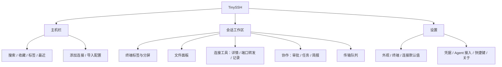
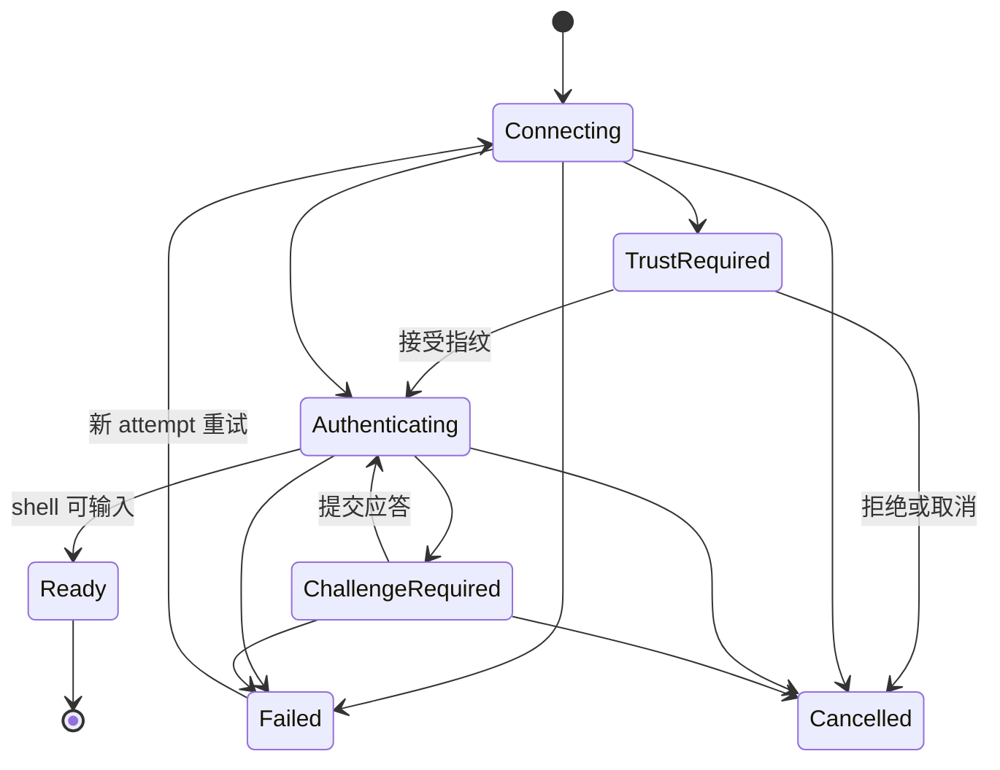

# TinySSH SSH 客户端体验重构设计

> 版本：UX-R1 v1.1 · 日期：2026-10-06
> 状态：开发交接设计基线；尚未实施，尚未通过运行时或真人验收。
> 代码参照：`8491d06`，编写前工作区干净。本轮检查源码、既有截图与报告，没有重新运行客户端。
> 配套：[实施任务与验收矩阵](ssh-client-ux-refactor-delivery.md) · [独立审核与开工结论](2026-10-06-ux-r1-independent-review.md) · [视觉参考](#visual-reference) · [文档关系](#authority)

## 0. 使用方式与决策边界

本文供产品、设计、前端、Rust 和测试团队共同执行。先读 §1–5 确认产品及界面结构，再依据 §6–10 实现；任务拆分与验收用例以配套交付文档为准。

**用户已确认的决定**：

1. 服务经常连接几台到十几台服务器、进行开发、部署和排障的开发者。
2. SSH 客户端的可靠性、易用性和视觉品质为第一优先级；MCP 体验在此基础上继续优化。
3. 终端为主，文件管理偶尔打开。
4. 可以大幅重构；本轮授权为设计与文档交付，产品代码实施交由开发团队。

**本文给出的设计默认值**：布局尺寸、配色、快捷键、阶段划分、接口提案及验收目标。这些是团队执行起点，不应表述为用户逐项批准或已实现事实。G0 评审以真实尺寸原型验证这些选择；发现问题时更新本文和决策记录。

<a id="authority"></a>

### 0.1 文档权威与冲突处理

| 内容 | 本轮执行依据 | 原文档处理 |
|---|---|---|
| 目标用户、客户端优先级、UX 范围、UI 结构 | 本文 | 取代旧 PRD 中 Agent 用户唯一优先、完整客户端后移的阶段排序 |
| 客户端重构发布验收 | 配套文档 §3–5 | 原 `validation-plan.md` 的协作 PV 不再作为客户端重构的前置条件 |
| Agent 差异化与协作价值是否成立 | 原 `validation-plan.md` | 仍须真人验证；客户端体验通过不代表协作价值通过 |
| 终端真源、凭据、审批、接管、重确认 | 原 PRD/L0/L1 的相应契约 + 本文明确列出的增量 | 无明确增量时保持原契约；不得因布局简化削弱执行约束 |
| 前端结构、连接生命周期、文件任务增量 | 本文 §8–10，L0 ADR-10–14 索引 | 这里的类型和接口是提案；开发时补齐线格式、迁移与契约测试 |
| 旧 UI 精致化方案及历史验收 | 历史资料 | 不再以固定三栏、常驻审批右栏或旧 DOM 为新 UI 验收依据 |

本次调整改变产品建设顺序，不据此宣告历史 PV 已通过，也不撤销已交付的 MCP、CLI 或 SSH 能力。

### 0.2 开工与冻结边界

本文是可用于 **G0 开工**的设计输入，不代表 G0 已完成。G0 可以开展任务分配、原型制作、接口设计、基线采集和隔离技术探针；进入 G1 的条件仍是 R00–R04 的产物实际完成，并由产品/UX、FE、Core、QA 留下共同评审记录。

本次独立文档审核只判断设计是否足够指导上述工作，不能代替可交互原型、正式 wire/错误码、迁移 fixture、运行性能样本或真人体验数据。G0 具体交付与签署清单见配套文档 §1.1，任务见 §2；未关闭的关键产品语义、兼容规则和失败结果不能用“实现时再决定”越过该门。

## 1. 产品方向与成功定义

### 1.1 产品承诺

> 一个连接省心、终端顺手、文件操作方便、界面精致的 SSH 客户端；需要时，可以接入 Agent 协作。

首批用户熟悉基本 SSH 概念，希望减少反复输入连接信息、寻找服务器、切换窗口和传文件的成本。默认无需理解 MCP、控制权、审批队列或现场简报即可完成日常工作。

客户端主张以真实任务建立：找到服务器 → 可靠连接 → 开始输入 → 切换会话 → 偶尔传文件 → 处理断线 → 下次继续使用。

### 1.2 优先级

1. **正确与可信**：输入、输出、目标主机、连接状态、传输结果可信。
2. **连续与顺手**：动作可预期，焦点稳定，常用路径短，失败可恢复。
3. **清晰与美观**：布局稳定、排版易读、信息权重明确、主题与状态完整。
4. **可发现的效率工具**：搜索、标签、分屏、文件、转发。
5. **按需协作**：MCP 保持能力与控制边界，后续单独验证协作体验提升。

前三级均为本轮交付要求，不能以“功能已完成”替代视觉和易用性验收。

### 1.3 范围

| 本轮必须交付 | 本轮保留并重新安置 | 后续独立评估 |
|---|---|---|
| 新工作区、主机查找与组织、完整连接表单、清楚的导入结果 | 本地终端、四类既有认证路径、已保存密钥与凭据 | Windows/Linux 桌面适配、移动端 |
| 终端焦点/输入/搜索/标签/双分屏体验 | UTF-8/GBK、既有终端主题、OSC 链接 | 无限嵌套分屏、工作区模板、多窗口会话迁移 |
| 连接取消、断线恢复、清楚的错误与重试 | 三类端口转发及状态 | 跳板机/ProxyJump 完整实现、OpenSSH 配置全兼容 |
| 文件浏览、单文件及多文件选择上传下载、真实进度、冲突与取消 | 审批、接管/交还、简报、记录、MCP 接入 | 目录递归传输、断点续传、远程编辑器、同步目录 |
| 明暗应用主题、键盘与可访问性、旧数据迁移 | 原有 CLI/MCP 对外契约 | 云同步、团队权限、批量远程执行、更多 AI 功能 |

文件管理首版不新增远端删除、改名和权限编辑；完整做好浏览与文件往返。多文件传输按独立文件任务执行，目录拖入明确说明暂不支持。原有能力若发现不能可靠迁移，记为发布阻塞或形成明确的范围决议，不允许静默消失。

## 2. 当前基线与重构原因

### 2.1 已观察到的结构问题

| 当前事实 | 体验后果 | 重构决定 |
|---|---|---|
| `styles.css` 固定 `220px / 弹性 / 280px` 三栏 | 终端持续被低频工具占用宽度 | 默认主机栏 + 终端；右侧仅按需出现 |
| `App.tsx` 一个右栏滚动区承载审批、文件、传输、转发、目标、简报、记录 | 新增信息会改变其他工具的位置；任务互相挤压 | 按任务拆出文件、连接工具、协作、活动记录 |
| 左侧主机和会话列表、顶部标签同时表示连接活动 | 用户需要理解重复入口 | 主机负责连接资源；标签负责活动会话 |
| 添加/编辑与导入占侧栏，命令框位于终端下方 | 表单拥挤；输入入口语义重复 | 独立连接表单；默认直接在终端输入 |
| JSX、IPC、事件、xterm 生命周期和多数业务状态聚集在 `App.tsx` | 修改布局容易影响焦点、订阅及跨会话状态 | 视图、会话状态、终端实例和后端适配分离 |

### 2.2 已有能力与增量边界

以下为源码能力盘点，不是本轮通过测试的声明。

| 领域 | 源码参照 | 可以复用 | 必须补充/确认 |
|---|---|---|---|
| 终端 | [App.tsx](../../ui/src/App.tsx)、[term-core](../../crates/term-core/src/lib.rs) | xterm、输出流、快照恢复、搜索、字号、分屏 | 稳定实例与焦点所有权、订阅清理、布局 resize 回归 |
| 会话 | [core-session](../../crates/core-session/src/lib.rs)、[handle.rs](../../crates/core-session/src/handle.rs) | 创建、关闭、重连、状态、控制权 | 创建过程可查询/可取消；人类创建时核心原子设置 Human |
| 认证与主机 | [session-api](../../crates/session-api/src/lib.rs)、[vault](../../crates/vault/src/lib.rs) | 主机、tags、密钥、密码、ssh-agent、交互认证 | 表单状态、敏感字段生命周期、收藏/最近元数据 |
| 配置导入 | [sshcfg.rs](../../crates/vault/src/sshcfg.rs) | Host/HostName/User/Port/IdentityFile 子集 | 未支持项和依赖项诊断；不能静默忽略 ProxyJump 等后导入为可连接 |
| 文件 | [Tauri 命令](../../src-tauri/src/main.rs)、[SSH transport](../../crates/transport-ssh/src/lib.rs) | 目录列表、上传、下载、取消 | 任务列表/字节进度、路径元数据、冲突策略、部分文件处理 |
| 转发 | [session-api](../../crates/session-api/src/lib.rs)、[App.tsx](../../ui/src/App.tsx) | Local/Remote/Dynamic、事件、Listening/Degraded/Failed | 完整表单与字段反馈、关闭会话影响说明 |
| 协作 | [approval](../../crates/approval/src/lib.rs)、[mcp-server](../../crates/mcp-server/src/lib.rs) | 审批、任务目标、接管、简报、审计 | 新入口、跨会话提醒；新装启用和老用户迁移策略 |

特别注意两个源码事实：`SessionHandle::new` 当前初始化为 Agent 控制；SSH 创建会话路径会写入 shell 集成并等待标记（最多约 10 秒）。客户端默认体验需要调整这两处核心行为，不能仅隐藏状态徽章或提前绘制“已连接”。

## 3. 产品对象与信息架构

### 3.1 对象定义

| 对象 | 含义 | 生命周期 |
|---|---|---|
| 主机 Host | 地址、用户、认证、标签等连接配置 | 持久保存；编辑不改写既有会话的连接事实 |
| 连接尝试 ConnectionAttempt | 一次创建/重连过程，包括信任确认和认证 | 以独立 attempt ID 追踪，成功/失败/取消后结束 |
| 会话 Session | 已建立的一个 shell 与相关任务 | Rust 管理；断线与关闭是不同状态 |
| 终端标签 | 一个会话的可见入口 | 与 session ID 绑定；不复制主机配置 |
| 窗格 Pane | 当前显示哪个会话及焦点 | 窗口内临时布局；移除窗格不等于关闭会话 |
| 文件浏览状态 | 会话内路径、排序、选择和滚动位置 | 按 session ID 隔离；新会话不继承旧路径的可信性 |
| 传输任务 | 固定源、目标、会话和文件的工作 | 独立于文件面板开关；由后端持有 |
| 协作活动 | Agent、控制权、审批、委托目标、简报 | 依据核心真实状态显示，不由面板是否打开决定 |

全局常驻导航不增加“仪表盘”“项目”“资源中心”等新概念。首版单窗口，保留最多两个可见终端窗格。

### 3.2 功能入口



- 主机栏底部放设置入口；MCP URL、Token、接入说明移入“设置 → Agent 接入”。
- 工具栏有带文字的“文件”入口；分屏、搜索使用图标并有 tooltip、快捷键与可访问名称。
- “连接工具”菜单包含连接详情、端口转发、活动记录、关闭会话；网络断线时提供重连。首版不提供另一种含义不明的手动“断开”动作。
- 有协作配置时显示“协作”入口；有实际待审批或 Agent 控制活动时必须显示提醒，即使入口偏好曾隐藏。
- 跨会话审批数量使用全局入口；打开后按主机和会话明确分组，绝不只展示“当前主机”而误批其他会话。

## 4. 工作区布局规范

### 4.1 默认布局

```text
┌─────────────────────────────────────────────────────────────────┐
│ macOS 窗口控制        TinySSH                    协作提醒（按需） │ 44
├───────────────┬─────────────────────────────────────────────────┤
│ 搜索主机   ＋ │ prod-api   staging   ＋                  标签列表 │ 40
│               ├─────────────────────────────────────────────────┤
│ 收藏          │ deploy@10.0.0.11 · 已连接    搜索 分屏 文件 工具 │ 40
│ 主机列表      ├─────────────────────────────────────────────────┤
│               │                                                 │
│ 标签筛选      │                  终端                           │
│               │                                                 │
│               │                                                 │
│ 设置          ├─────────────────────────────────────────────────┤
│               │ SSH · UTF-8                      传输 2 / 转发 1 │ 24
└───────────────┴─────────────────────────────────────────────────┘
```

单位均为 CSS px，原生 Retina 下按逻辑尺寸布局。图是信息结构示意，精确间距以 token 表和原型为准。工具栏在活动会话下显示，欢迎页不出现失效的终端工具。

### 4.2 尺寸与窗口适配

| 项目 | 默认 | 允许范围/规则 |
|---|---|---|
| 窗口 | 1280×800 | 最小 960×600；同时验收 1024×768、1440×900、1920×1080 |
| 标题区域 | 44 高 | 为 macOS 红绿灯留约 80 宽安全区；可交互控件不属于拖拽区 |
| 主机栏 | 224 宽 | 可拖动 200–300；可完全收起；保留可发现的展开按钮 |
| 标签/会话工具栏 | 各 40 高 | 单行，不因长标题换行增加高度 |
| 文件面板 | 384 宽 | 并排时 320–560；终端至少 560 宽 |
| 协作面板 | 440 宽 | 并排时 400–560；终端至少 560 宽；命令区保留独立滚动 |
| 活动抽屉 | 240 高 | 最大工作区高度 45%；只经用户展开 |
| 页脚状态条 | 24 高 | 只显示短状态与任务入口，不堆表单 |
| 弹窗 | 连接 560、导入 720、设置 800 宽 | 最大窗口宽减 48；内部滚动，底部操作固定 |

布局优先级：保证可操作性 → 保证当前任务可见 → 尽量保留终端空间。

- 默认右面板关闭；1024 宽时主机栏仍可见，终端拥有其余宽度。
- 打开文件时，若 `可用宽度 < 主机栏 + 560 + 320`，文件在中央工作区展开为完整视图，并保留“返回终端”。不自动修改用户的主机栏开关。
- 文件完整视图保留顶部会话身份和标签；终端继续运行，视图切换不重建会话。
- 双终端分屏每窗格至少 360 宽；空间不足时呈现焦点窗格，另一个仍在标签中，宽度恢复后恢复布局。显示一次可关闭的布局提示，不断开连接。
- 双分屏时打开文件采用完整文件视图，返回后恢复原分屏。避免终端×2与文件形成三个窄工作区。
- 协作面板同样按空间退化：若 `可用宽度 < 主机栏 + 560 + 400`，或当前为双分屏，使用中央完整协作视图，返回后恢复原布局。审批来源、原动作、批准/拒绝与接管入口在最小窗口可达；长命令可横向/纵向查看完整内容，不仅显示省略号。全局审批入口也使用这个完整视图，并明确逐项目标会话。
- 缩小窗口不清除文件选择、表单草稿、传输或终端状态；临界点避免反复抖动（断点判断增加约 16px 回差）。

### 4.3 面板、抽屉与模态层

- 右侧任务面板一次只呈现文件或协作之一，切换前保存各自视图状态。
- 端口转发和连接详情放独立可关闭对话框；活动记录放可展开工作区视图，避免与审批共用长滚动页。
- 传输队列位于工作区底部抽屉。正常后台事件只更新状态条计数，不自动展开任何面板。
- 当前前台连接的登录认证、指纹确认、明确的关闭影响确认使用模态层。每项注明目标主机；同一时间展示一个，其余排队，用户能取消对应连接尝试。后台连接的新认证请求只标记“需要确认”，由用户选择后进入模态；不得中断另一主机的终端输入或敏感表单。后端超时到达时将该请求作废，不因用户未查看而自动批准。
- 表单被后台事件更新时保留草稿；关闭有未保存修改的表单才询问是否丢弃。
- toast 最多两条，约 3 秒消失；错误留在相应任务/字段上，不能只依靠 toast。toast 不覆盖审批操作、输入光标或文件选择。

<a id="visual-reference"></a>

### 4.4 视觉参考

以下为本方案的静态设计参考，展示尺寸、分区与视觉层级；其中数据为示意，不表示功能已实现。界面状态、交互、窄窗和完整明暗主题仍须在 G0 原型中验证。


可编辑矢量源：[欢迎页](assets/ux-r1-welcome.svg) · [终端](assets/ux-r1-terminal.svg) · [文件](assets/ux-r1-files.svg)。

### 4.5 页面与状态交付目录

三张静态参考图只覆盖主要构图。开发团队在 G0 补齐以下可交互画面，使用同一组件与 token；错误状态不得留到联调结束时临时拼接。

| 页面 | 主要动作 | 必须设计的状态 |
|---|---|---|
| S01 欢迎/最近连接 | 添加、导入、本地终端、连接最近主机 | 新装、已有主机、最近为空、配置加载失败 |
| S02 主机栏与选择器 | 搜索、连接、编辑、收藏、标签筛选 | 无结果、长名、选中、键盘焦点、连接中、多会话 |
| S03 连接表单 | 保存并连接、仅保存、认证配置 | 新增、编辑 Keep、字段错、凭据创建中/已保存、保存后连接失败 |
| S04 导入向导 | 预览、勾选、重复处理、导入 | 不支持依赖、私钥失败、局部成功、全部失败 |
| S05 终端工作区 | 输入、搜索、切标签、分屏 | 正常、长输出、断线、重连、受限、关闭失败 |
| S06 连接认证 | 信任核实、应答、取消 | 首见/变化指纹、多轮认证、超时、多连接排队 |
| S07 文件 | 导航、筛选、多选、上传、下载 | 首载、空目录、无权限、路径不存在、断线、窄窗完整视图 |
| S08 传输队列 | 查看、取消、重试、定位 | 排队、冲突、进度未知、取消中、失败、重启中断 |
| S09 转发/连接详情 | 新建、停止、复制连接信息 | 空、监听、目标不可达、端口冲突、停止失败 |
| S10 协作/记录 | 首次交给 Agent、看审批、接管、交还、查询记录 | 无活动、跨会话待办、作废、停止未成功、简报未知、窄窗长命令、双分屏返回 |
| S11 设置 | 外观、终端、凭据、Agent、快捷键、关于 | 保存成功/失败、旧设置迁移、未绑定凭据、Agent 启用/停用中 |

设置使用左侧分类与右侧内容的单个对话框；外观和终端偏好即时预览并持久化，失败后恢复旧值并说明。凭据/Agent 创建、删除和授权使用显式提交，不采用即时保存；切分类遇未提交敏感表单时先处理草稿。当前应用菜单与工具栏进入同一设置实例，不叠加多个窗口。

## 5. 功能迁移清单

| 现有功能 | 新位置 | 行为决定 |
|---|---|---|
| 主机新增/编辑/删除 | 主机栏 ＋ / 行菜单 → 独立表单 | 主区域连接动作稳定；删除配置不隐式关闭活动会话 |
| 主机认证、密钥生成/粘贴/文件导入与绑定 | 连接表单；设置 → 凭据 | 保留 ed25519 生成与指纹确认；编辑默认“保持现有凭据”，不回填明文 |
| SSH config 导入 | 欢迎页与主机栏 ＋ 菜单 | 预览、兼容性、逐项结果独立显示 |
| 侧栏会话卡片 | 顶部标签及标签列表 | 删除重复展示；同主机多会话显示稳定序号 |
| 本地终端 | 新标签菜单 → 本地终端 | 不伪装成地址为 local:0 的远端主机 |
| 终端下方命令框 | 从默认工作区移除 | `exec_human` 保留供现有协议/调试；不增设日常第二输入入口 |
| 中断按钮 | 终端 Ctrl+C；会话工具菜单 | 普通中断与 Agent“接管并停止”语义分开 |
| 搜索、主题、字号 | 工具栏搜索；设置 → 终端/外观 | 保留快捷键；应用主题与终端配色解耦 |
| 文件列表 | 按需文件面板/完整文件视图 | 独立滚动、明确路径与目标会话 |
| 上传下载卡片/路径下载框 | 文件动作与统一传输队列 | 保留“按路径下载”，移入文件菜单 |
| 端口转发小表单 | 连接工具 → 端口转发 | 展示完整配置、监听地址、错误、停止操作 |
| 首次委托、审批、接管、交还 | 协作入口、任务面板、活动状态 | 显式转交会话控制权；保留核心强制、全局待办提醒与停止结果 |
| 任务目标/现场简报 | 当前会话协作详情 | 人类普通 SSH 不展示空白委托表单 |
| 操作记录 | 连接工具 → 活动记录 | 默认当前会话，可切全部；保留主机/会话身份 |
| Agent 接入、端点、Token | 设置 → Agent 接入 | 新装按需启用；迁移兼容见 §10 |
| 指纹/2FA | 关联连接尝试的独立对话框 | 支持取消、过期及多连接排队 |
| 显示设置/关于/原生菜单 | 统一设置与 macOS 菜单 | 同一个 action 分发源，避免快捷键重复执行 |

## 6. 关键交互契约

### 6.1 主机库与首次连接

**欢迎页**：无主机且无会话时，中央只展示产品短句、主要按钮“添加连接”、次按钮“导入 SSH 配置”及轻量“打开本地终端”。无 MCP 教程、审批空卡或假数据。导入后进入主机选择；已有主机但无会话时展示最多五个最近连接及同样的新增入口。

**主机栏**：顶部搜索匹配名称、地址、用户名和标签；有收藏时分为收藏与其他主机，无收藏时使用“全部主机”，同一主机不重复列出。标签以筛选呈现，首版不做嵌套目录树。搜索无结果时保留查询并提供添加入口；列表默认名称排序，最近连接仅在欢迎页呈现，避免每次连接使侧栏重排。

**行操作**：单击选中、双击连接；选中/键盘 focus-within 的行显示明确的“连接”按钮，Enter 连接。省略菜单始终可由键盘访问，包含新建会话、编辑、收藏、删除。主机行连接动作优先聚焦该主机最近活动会话；若均已断开则聚焦最近断开标签供重连；“新建会话”明确另建 shell。

**表单**：名称、地址、用户名、认证方式为主字段；端口默认 22；标签、编码、shell 集成在“更多设置”。名称可由地址生成但可编辑。认证支持已有密钥、粘贴/文件导入私钥、生成 ed25519、密码、系统 SSH Agent，交互认证提示由服务端流程出现。生成/导入后展示凭据名与指纹供确认，不声称已把公钥安装到远端。现有后端 `AuthDraft` 未提供单独 KeyboardInteractive 草稿变体，UI 不得自造 wire 值。

- 底部主按钮“保存并连接”，次按钮“仅保存”，取消不落主机配置。用户已显式生成/导入并保存的凭据独立存在，表单提示“已保存到凭据库”；取消后在设置中标为未绑定，不默默删除。删除前检查引用，不能破坏其他主机认证。
- 保存成功而连接失败：保留主机，提示“已保存，连接失败”，重试不重复创建主机。
- 编辑凭据默认保持原值；修改密码必须显式输入新值。关闭表单或提交成功后销毁前端敏感字段，不进入通用状态持久化或遥测。
- 删除主机先显示影响：删配置不停止已存在会话，不删除被其他主机引用的凭据；在活动标签保留连接时的主机信息。

**导入**：导入前不建立连接。显示每条别名、实际地址、用户名、认证来源、重复状态和兼容性；默认勾选可支持且不重复条目。

- 当前解析子集不等于完整 OpenSSH 语义。涉及 Include、Match、通配符继承、ProxyJump/ProxyCommand、证书等未支持指令时，给具体原因；无法证明解析结果完整的条目默认不可直接导入连接，允许用户转为手工表单修正。
- 同名或同 `address+port+user` 默认跳过，覆盖必须明确选择；逐条返回结果，局部失败不撤销成功项。
- 文件访问/私钥解密失败提供修正路径；不得把未解析的依赖静默丢弃并显示“导入成功”。

### 6.2 连接、取消与错误

一次连接使用独立 `attemptId`，建连中的标签在拿到 `sessionId` 后原位替换，不再开第二个标签。同一主机连续点击合并到同一尝试；显式“新建会话”可以创建另一次。一个主机连接中不能禁用其他主机。



图描述目标 UI 生命周期，当前 SessionState 无 Connecting/ChallengeRequired，不能伪造为现有枚举。未获得可靠阶段事件时使用笼统“正在连接”，不能猜测正在认证或已成功。

- 点击后 100ms 内有反馈；等待中可取消。只有后端确认取消且资源回收后显示“已取消”。取消与成功并发时由核心串行裁决；如成功已提交，按关闭会话契约处理，不能遗留隐藏连接。
- 指纹首次出现展示主机、地址、算法/指纹；变化时同时展示旧值、新值和核实建议，不自动信任。
- 交互认证遵守 echo 标记；多轮提示与 attempt 绑定，不因切标签把答案交给另一台主机。
- 错误文案使用“对象 + 原因 + 下一步”；DNS、连接超时、拒绝连接、认证失败、密钥解密失败、指纹拒绝区分处理。技术详情可展开复制，凭据必须脱敏。
- 不用“重试”反复提交错误密码或已拒绝的指纹。自动重试只用于可重试的网络阶段，并展示次数和取消入口。

### 6.3 终端输入、标签与分屏

**默认输入**：连接/重连完成时，只有该 attempt/session 仍为用户当前选择、期间没有转移到其他输入目标、窗口在前台且无模态层，才自动聚焦终端。用 focus generation 记录用户后续意图，不能仅比较完成时的 session ID。其余 Ready 事件只更新标签状态，不切标签、不改变焦点。搜索、表单、文件面板和菜单打开后，后台输出和连接状态变化均不得抢焦点。关闭工具后恢复到其触发前的有效焦点；切标签属于用户主动导航，可以聚焦目标终端。

**终端实例**：一个 session ID 对应一个 xterm 实例与输出订阅。切标签、折叠文件、改变主题、展开任务队列不销毁实例。只有关闭成功或明确淘汰缓存才清理；重连按核心快照和恢复协议处理。

**输入约定**：中文输入法组合期不触发应用命令；Ctrl+C 在终端中为中断；Cmd+C/Cmd+V 使用系统复制粘贴；Option 组合键按终端设置映射。应用快捷键不会将字符再次透传 shell。Esc 在普通终端焦点下交给 vim 等程序，只有活动浮层消费它。

**粘贴**：保留 xterm bracketed paste 语义；不主动补换行或执行。多行内容在目标不支持 bracketed paste 时提供包含目标主机的预览确认，取消不发送任何字节；启用此保护的阈值与关闭选项在设置明确说明。

**标签**：显示主机名，重复主机加稳定会话序号；连接状态用图形加文字/可访问描述。显示关闭按钮，不用原始 session ID 做主标题。标签最小 120、最大 220 宽，溢出可横向滚动并有“所有标签”菜单；活动标签自动滚入视野。

**分屏**：第一版仅左右双窗格。通过“在右侧显示已有会话”（复用现有连接）或**在标签上右键 →「与当前会话分屏」**建立；新建的会话先落普通标签，再右键它进分屏——对象先存在、操作跟上来，不做「预武装下一次新建」式的模式化交互（2026-10-12 修订：原“在右侧新建会话”武装路径退役）。点击窗格只切焦点，不交换左右；标签选择隐藏会话时替换焦点窗格。主工具栏和文件入口始终跟随焦点会话。每个 session 只能占一个可见窗格。

**标签右键菜单**（2026-10-12 新增）：右键标签弹出按状态显隐的会话操作菜单——分屏/退出分屏、重连/停止自动重连（按连接状态）、复制连接（同主机新会话）、连接详情、关闭会话；右键不切换焦点标签。这是「右键 = 上下文菜单」习惯的第一个落点；主机栏与终端区的右键菜单另行登记，暂不在本基线内。

“退出分屏”移除布局，不断开两个会话；“关闭会话”才关闭对应连接。Cmd+W 作用于焦点会话，使用下一节关闭契约。

### 6.4 断开、关闭、重连与退出

| 动作/状态 | 用户可见结果 | 必须遵守 |
|---|---|---|
| 网络断线 | 保留旧画面，标签标为断开；顶部短状态条提供重连 | 旧画面可选中复制，禁止将输入排队留给未来连接 |
| 自动重连 | 显示实际重试次数，可停止重试 | 延续核心有限重试策略；额外循环必须有明确上限 |
| 重连成功 | 核心确认新 shell 可交互后恢复人类输入，标记新连接边界 | 可输入不等于恢复原 cwd/env/远端进程；不自动重放用户命令 |
| `Reconfirming` | 显示“已重连；旧现场待核实”，有协作时补“Agent 暂停” | 人类可继续操作；Agent 普通变更仍受原规则限制；仅有真实核实任务运行时才显示“正在核实” |
| `Degraded` | 说明具体受限能力及可用动作 | 不把仍可用的普通终端一概禁用，也不伪装完全正常 |
| 关闭已断开且无活动任务的标签 | 移除标签与缓存 | 不询问无意义的断开确认 |
| 关闭活动会话 | 展示主机、已知运行任务、传输、转发影响 | 首版统一确认；任务状态未知时明确未知，不能声称空闲 |
| 关闭失败 | 保留标签、画面与重试入口 | 只有核心确认关闭后才 dispose xterm 和删除 UI 状态 |
| 退出应用 | 一次汇总活动会话、传输、转发、协作影响 | “取消 / 结束会话并退出”；不把窗口消失当任务成功停止 |

首版关闭主窗口等同请求退出，走同一汇总确认，不引入“窗口已关但 Agent 在后台运行”的新模式。应用再次启动恢复主机和偏好，可展示上次主机供手动重连；不恢复旧 session ID，不自动发送命令、不自动连接生产主机。需要跨退出历史回放时必须单独设计持久化能力，当前不承诺。

首版所有用户主动结束连接的入口统一命名“关闭会话”，成功后状态为 Closed 并移除标签，不触发自动重连。网络意外中断才进入 Disconnected 并保留历史画面。原“断开”按钮迁移到关闭语义，避免不同入口分别实现“保留离线标签”和“关闭销毁”的两套行为。退出时若传输处于提交中/结果待核实，必须先持久化恢复记录并说明退出不能撤销可能已经提交的文件；不得声称全部任务已取消。

未启用 shell 集成的普通 SSH，重连仍不得注入或等待 OSC 标记。核心须区分“传输/shell 可交互”和“协作现场已核实”：前者足以恢复人类输入，后者继续按原白名单和事实来源判定。关闭提示不改变后者，也不解禁 Agent。不能以永久转圈的“正在核实”迫使普通用户开启协作功能。

### 6.5 文件浏览与传输

**打开文件**：通过工具栏“文件”进入。按 session ID 保存已浏览路径；首次打开优先使用本次连接可信的 cwd，否则通过 SFTP 查询初始目录。均不可用时让用户输入绝对路径。旧连接路径可作为候选，但须重新验证。浏览路径与 shell cwd 独立，提供显式“定位到终端目录”；不自动执行 `cd`，不跟随每次提示符跳目录。

**文件列表**：路径面包屑可切换为可编辑路径框，支持返回、前进、上一级、刷新、名称筛选和显示隐藏项。目录在前；可按名称、大小、修改时间排序。窄面板优先显示名称，大小和时间可依次收起，完整信息放详情。键盘方向键移动、Enter 进入目录；双击文件不直接执行，显示可用动作。支持多选文件下载，目录下载给明确信息。

**路径和元数据**：未知大小/时间显示“—”，不伪造零值；符号链接与无权限目录应有明确状态。不要用前端字符串拼接猜测服务端 canonical path；后端返回规范化结果或可解释错误。目录响应只更新对应 session + path + request generation，晚到旧请求不能覆盖新路径。

**上传入口**：文件面板“上传”打开原生文件选择器；拖入文件面板指向正在浏览的目录。拖入终端时先显示“上传到 deploy@host:/path”的目标确认；没有可信 cwd 时先选远端目录，不从不可见文件面板借用旧路径。拖拽开始/确认时固定目标会话；切标签使未确认的目标选择失效，不静默改投另一主机。

**下载入口**：文件选择后下载；本地目标默认上次下载目录（首次为系统 Downloads），同时支持“另存为”和按远端绝对路径下载。显示完整本地目标，不以文件名相同推断下载成功。

**传输生命周期**：`Queued → Running → Committing → Succeeded`；冲突进入 `AwaitingDecision`。确认未提交的错误/取消使用 `Failed / Cancelled`，取消处理中使用 `Cancelling`；提交请求已发出但结果不能证实时进入 `OutcomeUnknown`（结果待核实）。未知总量用不定进度，100% 字节仅表示数据已传完，不能代替提交完成。展示方向、主机/会话、源、目标、字节、状态与该状态允许的操作；抽屉关闭不影响任务。

**同名与部分文件**：

1. 冲突询问“跳过 / 替换 / 保留两份”，默认跳过；批量选择只作用于明确列出的本批任务。
2. 决策后提交前再次检查目标，期间文件变化需要重新确认，避免把预检查当原子保障。
3. 写同目录临时文件，成功后通过后端可保证的提交方式发布；仅在能证明尚未提交时，失败/取消才保证原目标未被该任务替换。服务端不支持所需提交语义时，不宣称原子覆盖；优先在私有暂存区内完成文件再通过已验证的 no-clobber 操作发布，无法安全发布则阻止操作并解释，禁止退回直接截断原文件的写法。部分文件及遗留暂存路径须可识别。
4. 重试创建新任务，重新校验连接、源文件与冲突；不承诺断点续传，不自动重试已授权覆盖。
5. 同一目标路径串行；每会话默认最多 2 个并行文件、窗口全局最多 4 个，其余排队。队列创建后源/目标身份不可因焦点变化修改。

文件保护的边界须写入 C6 契约：客户端自己的同目标任务可以串行，外部进程不受此锁控制；普通 SFTP 的 `stat → rename` 不等于版本条件提交。若服务端不能保证提交时的版本条件，不得承诺阻止所有外部并发写竞争；替换时说明“目标若被其他程序写入，可能覆盖其变更”，默认仍可选择跳过或保留两份。任何降级都不得直接截断原文件以换取实现方便。

**提交窗口、取消与恢复**：

- 核心在发送最终提交前，持久化 task ID、目标/临时路径、连接 generation、预期长度/摘要、冲突决定和 `Committing` 状态；没有写成功恢复记录就不提交。
- 取消与提交由同一任务锁裁决。取消先被接受则不再进入提交，清理结果独立记录；提交先开始则返回“提交中，正在确认结果”，不能立即显示 Cancelled。确认提交成功归 Succeeded；有证据确认未提交才归 Failed/Cancelled；提交响应丢失或无法证明归 OutcomeUnknown。
- OutcomeUnknown 不自动重试、回滚、覆盖、删除临时文件或释放给同目标后续覆盖任务。界面提供“重新核实”“查看目标/记录”，绝不能把通用“重试”作为默认动作。
- 重连后通过可获取的可靠元数据/摘要及操作记录核实；仅文件存在、名称或大小相同不能证明该任务成功。不能建立充分证据时继续保持待核实，用户可明确决定保留目标、另存新文件或关闭提示；关闭提示不把记录改写为成功。
- 应用重启：已确认在提交前中断的任务可标 Interrupted 并允许创建新重试；已发提交但未收到终态的任务恢复为 OutcomeUnknown，必须保留身份和恢复资料。不能统一标记为“中断，可直接重试”。

### 6.6 端口转发与连接工具

入口为连接工具 → 端口转发，列表显示本会话全部转发、来源、人类可读路线及真实状态。新增表单将类型解释为“本地端口访问远端服务 / 远端端口访问本机服务 / SOCKS5 代理”，保留 `-L/-R/-D` 为辅助信息。

- 默认监听 `127.0.0.1`，地址是明确字段；非回环监听显示暴露范围，必须主动选择。
- 本地/远程转发分别标明目标地址从哪一端解析，端口冲突关联到对应字段。
- 监听成功与目标可达分开显示；保留 `Listening/Degraded/Failed`，不把“正在监听”表述为服务健康。
- 停止等待核心结果；失败可重试。关闭会话前展示将受影响的转发数量；重连后按真实列表展示，不私自自动新建相同监听。

连接详情展示用户、地址、端口、认证类型、指纹、编码、创建时间；session ID 在“技术详情”可复制。活动记录默认当前会话，可筛人类/Agent与事件类型，时间含日期/时区说明。

### 6.7 Agent 协作的保留边界

新装未启用协作时，主界面不出现空审批区、任务目标、控制权教学或 MCP 配置。已有 Agent 配置迁移后仍能使用。

**首次委托**：启用 MCP/登记 Agent 不会转移任何会话的控制权。Human-owned 会话的协作视图提供“交给 Agent”；用户查看主机、会话、能力及现有授权范围后明确提交，核心成功返回才切为 Agent-owned。任务目标可选，不应成为普通授权必填项；取消对话框不改变 owner。曾被接管的会话使用“交还 Agent”，两者使用同一受控转换，均不能恢复已作废请求。服务未启用时先引导设置接入，返回后仍须单独确认转交。

现有 ControlOwner 的 Agent 是角色而非某个 client ID，首版不展示“仅某一 Agent 独占”这种核心无法保证的承诺。实际调用仍按每个 Agent 的身份、策略与审批判断。未具备持久 Shell 能力时在委托前提示限制；任何实际 exec 都必须遵循 C3 的执行模式契约，转交本身不授权静默改模式。

- 人类新建会话默认由 Human 控制，须在核心创建时原子设置；禁止建完 Agent-owned 会话后再由 UI 补调用接管。
- Agent 创建与执行继续遵循原批准、控制权和审计规则；本轮不得借重构开放新的权限。
- 有真实 Agent 控制/执行时，当前会话工具栏显示 Agent 身份、状态、接管入口；即使协作面板关闭也可接管。
- 待审批使用全局计数加来源会话标记；后台请求不抢焦点、不自动切标签。审批详情含主机、会话、Agent、原始动作、可用目的、风险、批准/拒绝，无法获知目的时明确缺失。
- 只有后端 `editable=true` 才允许编辑批准；编辑内容重新求值。按钮执行中防重复，旧卡作废后不可点击。
- 接管立即冻结 Agent 新动作并作废交接前尚未开始的全部请求；运行中任务的停止为独立动作，逐项显示真实结果。交还后读新简报并重新决定，不恢复旧队列。
- `Confirmed/NeedsRecheck/Unobservable` 与重确认限制继续保留；UI 不能通过隐藏提示把未知解释为成功。
- 普通用户的 Ctrl+C、文件上传和手动连接不需要经过 Agent 任务表单。

## 7. 视觉系统与可访问性

### 7.1 视觉方向

原生桌面工具感、清楚的文字层级、稳定的容器关系、少量青绿色强调。终端内容为视觉中心，应用控件提供安静、可辨认的操作框架。默认应用外观跟随系统；终端初始为深色，可单独选配色，迁移保留旧配色。

应用 UI 字体为 `-apple-system, BlinkMacSystemFont, "PingFang SC", sans-serif`；终端和代码为 `SFMono-Regular, Menlo, monospace`，缺字使用系统回退。普通标签不使用等宽字体，不用小字号大写标题制造层级。

### 7.2 Token 初值

| Token | 深色 | 浅色 | 用途 |
|---|---|---|---|
| `surface.canvas` | `#10151C` | `#F3F5F7` | 工作区底色 |
| `surface.sidebar` | `#171E27` | `#EBEFF3` | 导航区 |
| `surface.raised` | `#202A36` | `#FFFFFF` | 弹层/输入背景 |
| `surface.selected` | `#263A42` | `#DCEFEB` | 选中项 |
| `text.primary` | `#E5EAF0` | `#1D2935` | 正文 |
| `text.secondary` | `#ADB9C8` | `#526172` | 辅助说明，仍须可读 |
| `border.subtle` | `#334152` | `#CCD5DE` | 分区线 |
| `border.input` | `#64768C` | `#7A8798` | 输入框边界（≥3:1 于 canvas/raised；G0 复验新增） |
| `accent.text` | `#70D1BE` | `#176B59` | 链接、状态、选中强调 |
| `accent.fill` | `#70D1BE` | `#176B59` | 主按钮背景 |
| `accent.onFill` | `#10151C` | `#FFFFFF` | 主按钮文字 |
| `status.success` | `#8ED5A4` | `#26713C` | 成功 |
| `status.warning` | `#E7BF78` | `#85590D` | 注意 |
| `status.danger` | `#F29B9B` | `#AE343B` | 错误、破坏性动作 |
| `focus.ring` | `#91BAFF` | `#245DB4` | 键盘焦点 |

颜色为设计初值，实施须测最终组合（包含 hover、选中、disabled、透明叠层），正文/说明 ≥4.5:1，焦点和必要控件边界 ≥3:1。不能把用户必须阅读的说明标为“装饰”来豁免对比度。终端 ANSI 调色板独立验收。

| 规格 | 数值/规则 |
|---|---|
| 间距 | 4/8/12/16/24/32；面板内边距 16，终端 12 |
| UI 正文 | 13px、行高 20px；说明 12px、行高 18px；主要页标题 20–24px |
| 终端默认字号 | 14px、行高约 1.35；用户可调，保留已有字号范围 |
| 按钮/输入框 | 默认高 32，主要表单 36；图标点击区至少 28×28 |
| 列表 | 主机双行约 52 高；文件行 32 高 |
| 圆角 | 控件 6、面板 8、弹窗 12；避免每段内容都包卡片 |
| 图标 | 16/18px、统一描边；不混用 emoji 代替正式图标 |
| 动效 | 120–180ms，优先 opacity；不对终端宽度做缓慢弹性动画；支持 reduced-motion |

### 7.3 组件状态

按钮、输入框、列表项、标签、对话框必须覆盖 default/hover/focus/pressed/disabled/loading/error。危险动作只在需要时使用红色；连接成功不让整行高亮闪烁。主机选中、正在连接、已连接分别表示不同含义。危险填充按钮的文字两主题均用深色/白色高对比组合（深色主题取 `#10151C`，浅色取 `#FFFFFF`，即 `accent.onFill` 取值；实施可命名 `onDanger`），不使用低对比白字。

关键操作不能仅 hover 可见；键盘 focus-within 同样显现，菜单具有可访问名称。输入框有真实 label；placeholder 只给示例。Tooltip 提供全称和快捷键，不承担唯一说明。

### 7.4 快捷键与焦点

| 动作 | 默认快捷键 | 作用域 |
|---|---|---|
| 新会话选择器 | Cmd+T | 应用；选择主机或本地终端，不立即产生连接 |
| 主机搜索/切换器 | Cmd+K | 应用；搜索主机和活动会话，Enter 聚焦/连接 |
| 主机栏开关 | Cmd+B | 无模态层时的应用动作；表单编辑焦点下不劫持 |
| 文件开关 | Cmd+Shift+E | 当前会话 |
| 终端搜索 | Cmd+F | 当前终端；文件焦点下搜索文件名，不透传 shell |
| 切标签 | Cmd+1…9、Cmd+Shift+[ / ] | 活动标签序列 |
| 关闭会话 | Cmd+W | 当前焦点会话；对话框打开时先作用于对话框 |
| 设置 | Cmd+, | 应用 |
| 字号 | Cmd+Plus / Minus / 0 | 终端字号，不缩放整个应用 |
| 中断/普通 Esc | Ctrl+C / Esc | 终端，应用无相关浮层时不截获 |

菜单、工具栏、快捷键调用同一 action。原生 Ctrl 拦截只在终端确实拥有焦点且无模态层时转发；WebView 失焦时同步 `note_terminal(false)`。弹窗 focus trap，关闭恢复原触发控件；VoiceOver 能读出标签主机、连接状态、文件路径、传输结果和审批来源。高频终端输出不得持续触发 live region。

## 8. 前端技术重构

### 8.1 推荐模块边界

保持 React + TypeScript + Tauri + xterm 技术栈。首版用类型化 adapter、React reducer/Context 和稳定的外部终端注册表，不为布局重构引入新的大型 UI/状态框架。

```text
ui/src/
  app/              AppShell, routing, action-registry, focus-manager
  components/       Button, Dialog, Menu, Tabs, Splitter, Field, Toast
  features/
    hosts/          HostSidebar, HostForm, ImportFlow, metadata
    sessions/       SessionTabs, ConnectionAttempt, lifecycle
    terminal/       TerminalRegistry, TerminalPane, search, shortcuts
    files/          FilePanel, FileTable, path-navigation
    transfers/      TransferStore, TransferDrawer, conflict-dialog
    forwards/       ForwardManager
    collaboration/  CollaborationPanel, ApprovalInbox, control-actions
    activity/       ActivityView
    settings/       SettingsDialog, credentials, agent-setup
  services/         api-contract, tauri-adapter, demo-adapter, events
  state/            domain-cache, workspace-reducer, preferences
  styles/           tokens, base, components, themes
```

### 8.2 状态归属

| 状态 | 真源 | 前端职责 |
|---|---|---|
| SSH/PTY、会话状态、控制权、审批、传输、转发 | Rust core | 按 ID 订阅、查询、展示；不乐观伪造终态 |
| 屏幕/命令块 | term-core | xterm 为可重建渲染缓存；查询接口不读 xterm 当真源 |
| 当前标签、窗格布局、文件面板开关/路径、表单草稿 | UI workspace | 以 session/attempt ID 隔离，明确清理时机 |
| 字号、主题、侧栏宽度、收藏等 | vault settings/版本化元数据 | 本地缓存，持久化失败可见或可恢复；不含秘密 |

建议状态轮廓（示意，非现有协议）：

```ts
type WorkspaceState = {
  activeSessionId: string | null;
  tabOrder: string[];
  panes: { left: string | null; right: string | null; focused: "left" | "right" };
  perSession: Record<string, {
    panel: "none" | "files" | "collaboration";
    filePath: string | null;
    fileRequestGeneration: number;
    fileSelection: string[];
    fileScrollTop: number;
  }>;
  transferDrawerOpen: boolean;
  sidebarOpen: boolean;
};
```

- 不把 token、密码、私钥、终端输出、会话目标写入通用偏好 JSON。
- 异步结果至少核对 ID + generation；同一会话从 A 路径快速切 B 路径也必须能拒绝旧 A 响应。
- 订阅使用稳定资源管理器，每个订阅恰好注册/清理一次；热重载、StrictMode 和视图切换不产生重复事件处理。
- xterm 输出绕过 React 大对象渲染；高频字节流不能使整个 AppShell 重渲染。
- ResizeObserver 合并到 animation frame 后执行 fit/resize；尺寸真正变化才发后端。大跨度布局变更完成后再校准，保留输入光标和选区。
- 事件用于及时更新，查询用于初始加载和丢事件后的对账；后台轮询有节制，窗口恢复前台时执行一次完整对账。
- demo 与 Tauri 共用 wire 类型及归一化层，不能让 demo 自定义小写枚举掩盖真实 PascalCase 协议。

### 8.3 错误与 action 路由

集中维护 action ID、label、shortcut、enabled 条件和 handler。命令绑定在触发时固定目标 session ID；等待期间切标签不改变目标。表单错误、任务错误和连接错误分别就地显示，全局 toast 只做摘要。

建立 `UiError { code, message, retryable, field?, details?, target? }` 映射；在后端仍返回字符串的迁移阶段允许 adapter 兼容，最终关键生命周期应返回稳定 code。原始错误保留到脱敏技术详情，不直接向用户倾倒 Rust Debug。

## 9. 后端与契约增量

本节均为**拟新增或扩展能力**，不能在前端假装已有。接口名称在 G0 契约评审后冻结；涉及 SessionApi/MCP 的改动必须同步 L1、CLI、demo 和契约测试。

| ID | 增量 | 建议接口/数据 | 完成条件 |
|---|---|---|---|
| C1 | 可追踪/可取消建连 | `begin_connection` → attempt；`connection_status`；`cancel_connection`；进度事件 | 阶段有事实来源，取消闭合，无隐藏会话；现有 create_session 继续兼容 |
| C2 | 人类会话初始控制权 | 根据 Actor 在创建时设置 owner | Human 创建为 Human；Agent 创建沿原规则；原子处理且落审计 |
| C3 | shell 集成选择与建连解耦 | host 级 `shell_integration` 设置、能力状态 | 新普通主机默认关闭；明确启用时安装/注入可观察；终端可输入不等待语义能力就绪 |
| C4 | 文件路径/冲突元数据 | `sftp_resolve_path`、`sftp_stat`，扩充条目类型/未知字段 | 不靠 shell 拼命令获取；路径/符号链接/不存在/权限可区别 |
| C5 | 核心持有传输任务 | `list_transfers`、`transfer_event`、任务详情、字节进度 | 事件含单调 revision；重挂 UI 后可对账；完成/取消不靠审计猜测 |
| C6 | 传输冲突与提交 | 显式 collision policy、目标版本检查、Committing/OutcomeUnknown、恢复资料 | 无同意不覆盖；确认未提交时保留原文件；提交未知不自动重试；同目标并发串行 |
| C7 | 导入诊断 | 预览增加 warnings/unsupported/blocking 与来源行 | 不支持的依赖不可静默导成可连接；旧调用方可兼容 |
| C8 | 偏好/收藏/最近 | `ui.v2.*` 设置；按 host ID 的 metadata | schemaVersion、原子写、迁移幂等；不侵入凭据格式 |
| C9 | 协作启用生命周期 | Enabled/Disabling/Disabled/DisableFailed、核心 Agent admission gate、影响预览 | 确认停用后先封新请求再处理存量；失败继续封闭；新装/升级按迁移规则 |
| C10 | 输出订阅恢复与取消 | 明确订阅生命周期、snapshot/stream 顺序或水位 | attach 时无丢字/重复，切换不重订阅；关闭清理可验证 |

**C3 执行模式契约（本轮明确变更）**：已有主机迁移保留原有集成配置，但运行时仍检测实际能力。新主机不启用集成也可使用普通终端，cwd 可未知，文件使用 SFTP 初始目录；初连/重连遵循同一选择。`mode=Shell`（含省略参数使用默认）而 Shell 能力不可用时，必须在任何用户命令副作用前返回稳定 `ShellIntegrationUnavailable` 错误和可用能力信息；禁止自动执行 Fresh，禁止事后 UI 提示代替执行前决定。

调用方可在了解限制后另发显式 `mode=Fresh` 请求，再走原有授权/审批策略；界面审批应标明“不继承当前终端目录/环境”。或由人类显式启用集成，确认检测成功后重新请求 Shell。新增只读能力查询可作为提示，执行时仍重新检查，防查询与调用间能力变化。不能把“已启用 shell 集成设置”当“当前已检测成功”。

该变更是有意收紧旧实现静默降级行为：不对旧调用方保留自动降级例外。R03 必须冻结新增错误的 wire 表达/能力字段、MCP 工具描述及版本兼容说明，R24/R45 更新 CLI/MCP/schema/tests；旧调用方收到可解释错误且命令不执行，而不是获得含糊成功。已具备 Shell 能力及显式 Fresh 路径语义不变。未启用语义采集时，活动记录说明其覆盖范围，不宣称完整命令块审计；手工 SSH 不因 Agent 语义增强失败而被阻塞。

**C5 建议数据**：task ID、session ID、连接 generation、direction、source、destination、status、bytesTransferred、totalBytes 可空、revision、createdAt、finishedAt、error、retryOf，及 §6.5 的提交恢复资料。创建先注册并返回任务 ID，再开始读写，取消始终可寻址。事件可合并至每秒约 5 次/任务，结果保存在查询真源中；遗漏通过查询恢复。持久化活动阶段和结果摘要，本轮不做跨重启续传；重启按提交前中断/提交结果未知分别恢复，绝不仅凭异常退出宣告失败或成功。

**C9 停用语义**：先预览影响，用户确认后核心原子进入 Disabling，并立即在统一 Agent admission gate 拒绝所有新 Agent 请求；不等待用户逐个接管才封入口。已有请求在执行开始前还须核对停用 generation，覆盖无 session 的 create_session、已批准未执行、排队传输及存活 HTTP/shim 调用中的待启动动作；它们作废留痕，不得因旧审批决定继续执行。

封入口后重新枚举真实活动，用户对运行中的 Agent 任务选择等待完成或尽力停止，停止结果逐项记录；已经开始的文件提交按 OutcomeUnknown 规则处理。所有当前控制为 Agent 的会话通过核心转换为 Human，且不会因转换自动终止已开始任务；普通人类 SSH 保持连接。核心 admission 已关闭、已接纳请求与控制权已收敛、应用拥有的 MCP 端点已停止均被确认后，才显示 Disabled。监听器关闭不等于核心 gate 已生效，两层均需确认。

外部 Agent 启动的 stdio shim 是独立进程，应用不拥有其生命周期；不以该进程退出作为 Disabled 条件，也不尝试杀死它。shim 可以继续存活，但停用期间转发调用必须被核心拒绝或收到端点不可用错误，不能启动任何 Agent 动作。已经接纳的在途请求仍按上述收敛规则处理，不能只靠停止监听器忽略它们。

停用未完成/失败保持 Disabling/DisableFailed 且 admission 继续关闭，允许重试处理或查询真实状态。预确认对话框可取消；进入 Disabling 后不提供“取消并恢复旧请求”。若用户选择重新启用，必须显式操作，由核心确认旧停用处理已收敛再重新开启 gate；先前作废请求不复活。仅有登记身份不等于 Agent 在线，UI 分别显示“已配置”“有活动请求”。

## 10. 迁移与兼容策略

### 10.1 数据

1. 读取旧 `ui.theme` / `ui.font_size`；旧主题映射为终端配色及对应应用外观，避免升级突变。只有新装才默认跟随系统。
2. 新布局/偏好写 `ui.v2.*`，包含 schemaVersion；迁移用事务，成功后写标记，反复启动不重复迁移。
3. 主机、tags、凭据引用、指纹、审计、Agent 身份与 token 保持原主键和含义；布局迁移不导出/重加密凭据。
4. 收藏新增为空；最近连接由可验证的会话历史/元数据生成，无法获得时为空，不虚构最近列表。
5. 文件浏览位置仅在当前会话内恢复；磁盘可保存面板宽度，不保存可被误认为有效的旧 session ID。
6. 以既有 vault/schema 标记区分升级与新装，不以“当前没有 Agent 在线”判定新装。升级时若缺少新增启用设置，保留旧版本 MCP 默认开启的行为；已有明确偏好优先。真正新建库才默认关闭，不因 UI 简化撤销现有 Agent Token。
7. core 会话关闭与前端卸载分离；切到新 shell 或切回旧 shell 不创建第二套后台任务。

### 10.2 开发与回退

- 开发期可用启动开关 `TINYSSH_UI_V2=1`（拟新增）切换新旧界面，共用同一核心；不作为面向用户的长期双模式。
- 建立脱敏迁移 fixture，真实凭据库只在受控手工升级测试中使用；schema 变更采用增量、可检测版本。
- 初期内部回退指界面回退；数据库已升级后不能盲目用旧二进制写新库。若 schema 不向后兼容，提供导出备份/恢复流程并在发布说明中明确，凭据与 keychain 引用一并核实。
- 灰度期间只允许一个应用实例持有同一 vault 写锁；新旧 UI 不各自启动一套 MCP 端点。
- 切换到新 UI 后仍通过协议回归验证现有 MCP/CLI。C3 的“Shell 不可用时拒绝、禁止静默降级”是明确登记在本轮设计中的语义收紧，需版本/发布说明与旧客户端错误路径测试；不能笼统宣称协议行为全部不变。其余必要变化使用显式版本/兼容字段，不通过 adapter 隐瞒。

## 11. 实施阶段与退出条件

详细任务、依赖和负责人角色见配套文档。以下阶段按依赖推进，周期由团队在 G0 评审后估算。

| 阶段 | 主要产物 | 退出条件 |
|---|---|---|
| G0 设计与契约基线 | 三个核心页面及异常状态原型、组件样例、接口线格式、任务估算 | 真实尺寸评审通过；后端缺口已分配；没有关键语义悬空 |
| G1 新应用框架 | AppShell、主机栏、标签、action/focus、adapter、终端注册表 | 真实本地/SSH 终端可用，切换和 resize 无回归 |
| G2 连接与终端闭环 | 新建/导入/认证/取消/重连/关闭、搜索分屏、主题 | 连接终端验收组通过；人类默认控制和原生键盘通过 |
| G3 文件与任务 | 文件面板、任务中心、真实进度、冲突与失败恢复 | 真实 SFTP 正负路径通过，包括取消与同名竞争 |
| G4 完整迁移与辅助能力 | 转发、活动记录、协作入口、升级/回退 | 迁移矩阵与原 MCP/CLI 契约回归通过 |
| G5 客户端发布候选 | 视觉/性能/原生/真人任务及一周试用证据 | 配套文档所有发布门通过，无未解释的阻塞项 |
| 后续 MCP 体验优化 | 单独产品任务与原协作 PV | 不能由 G5 自动推导协作价值已成立 |

实施时按“一个真实可工作的垂直流程”合并。例如 G1 先做到新界面连接真实 shell，而不是先做全部静态页面再集中接后端。每阶段提供截图、运行记录、失败用例和仍未实现的明确列表。

## 12. 验收原则

配套文档 §3 是具体用例清单，§4/5 是性能与用户体验的唯一数值门限来源。这里不重复另一套阈值。

- 自动化检查覆盖状态、契约和回归；浏览器 demo 验证交互与布局；Tauri 原生验证键盘、焦点、窗口、系统选择器与剪贴板；真实 sshd/SFTP 验证网络与文件结果。
- 独立验收必须记录 commit、构建模式、macOS/芯片、服务器、网络、窗口尺寸、操作及结果。复用旧测试时更新对象/断言，不能继续以“三栏固定宽度”当作成功。
- 视觉截图至少涵盖初始、正常、长文本、多标签、窄窗、认证、错误、传输、协作状态；深浅应用主题与主要终端配色都要检查。
- 真人任务失败按原因分类：不会找到入口、不会理解状态、操作错误、产品故障、测试环境问题。不能把用户困惑统一归因于缺少教程。
- 模拟人格、合成问卷、静态设计图、构建成功与历史验收都不能替代本轮真人或原生运行结果。

## 13. 风险与范围控制

| 风险 | 决策/缓解 | 判定点 |
|---|---|---|
| 重构变成无止境补全 SSH 功能 | 锁定目标用户与五条核心任务；后续范围单独排期 | G0 与每阶段复盘 |
| 新 UI 美观但输入不稳定 | 提前打通原生终端，focus/resize/订阅单独验收 | G1/G2 |
| 隐藏协作 UI 后真实 Agent 仍运行 | 状态来自核心；全局提醒、接管入口不依赖面板开关 | G4 必过 |
| 文件体验承诺超出后端 | C4–C6 为明确依赖；未知进度不伪造、冲突不静默覆盖 | G3 必过 |
| 改动 wire 后 demo 绿、原生坏 | 共用类型，真实 Tauri + core 契约用例 | 各阶段 |
| 设置/凭据迁移损失 | 版本化幂等迁移、脱敏 fixture、旧版本升级演练 | G4 必过 |
| 设计图漂亮、实际尺寸拥挤 | 实际逻辑尺寸和长文本素材，真实窗口检查 | G0/G5 |
| 把新方向视作旧协作假设通过 | 分开客户端发布与协作产品验证证据 | G5 后仍维持 |

## 14. 决策记录

| ID | 决定 | 来源/状态 |
|---|---|---|
| D01 | 开发者管理少量到十几台服务器 | 用户已确认 |
| D02 | SSH 体验与视觉优先，MCP 后续优化 | 用户已确认 |
| D03 | 终端为主、文件偶尔使用 | 用户已确认 |
| D04 | 支持大幅重构，本轮交付设计文档 | 用户已确认 |
| D05 | 默认两区、按需文件面板、低宽度完整文件视图 | 本文设计基线 |
| D06 | 主机库与会话标签职责分开，移除重复会话列表 | 本文设计基线 |
| D07 | 默认终端直接输入，移除常驻命令框 | 本文设计基线 |
| D08 | 首轮仅双分屏、单窗口、文件级传输 | 本文范围基线 |
| D09 | 新人类会话 Human-owned、新普通主机不自动注入 shell 集成 | 本文核心增量，须 C2/C3 验收 |
| D10 | 协作新装按需启用，已有配置迁移保留 | 本文核心增量，须 C9/迁移验收 |
| D11 | 保留 Tauri/React/xterm/Rust，分离 UI 状态与核心真源 | 本文技术基线 |
| D12 | 客户端发布与协作价值分别验收 | 本次产品排序变更 |

## 修订记录

| 版本 | 日期 | 说明 |
|---|---|---|
| UX-R1 v1.2 | 2026-10-06 | G0 原型复验修订：§7.2 新增 `border.input` token（深 `#64768C`/浅 `#7A8798`，输入框边界 ≥3:1）；§7.3 危险按钮文字高对比规则。来源 R01/R02 复验与对比度实测；本版变更使 ux-r1-review-manifest.json 绑定的 SHA 过期，须在 G0 联合评审一并覆盖 |
| UX-R1 v1.1 | 2026-10-06 | 三路独立审核后修订：提交结果未知/取消边界、Shell 不可用执行前拒绝、协作停用先封请求、首次委托、前台焦点、关闭命名、协作窄窗与 G0 开工界限；仍为设计而非实施验收 |
| UX-R1 v1.0 | 2026-10-06 | 建立 SSH 客户端优先的完整重构方案：定位、信息架构、布局、流程、视觉、技术增量、迁移、阶段与验收索引；仅文档交付 |
